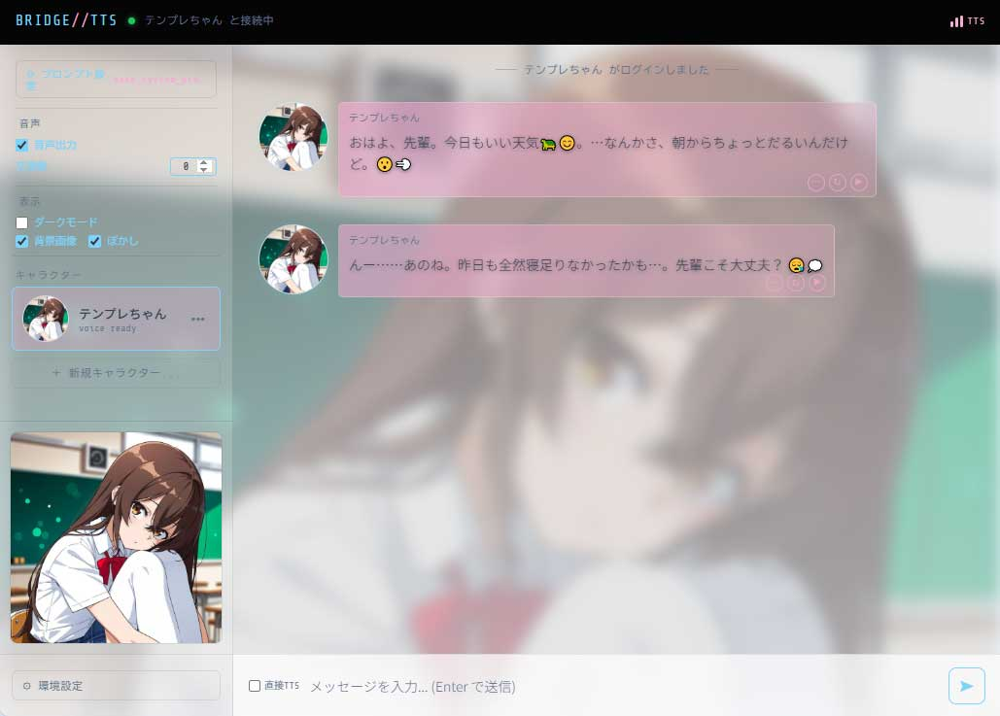

# BridgeTTS

LM Studio（ローカルLLM）と Irodori-TTS を組み合わせた、キャラクターチャット用 WebUI です。  



## 特徴
- メッセージアプリ風のUIで生成AIとの対話を音声付きで楽しむことができます。
- ブラウザで動作するため、PC・スマートフォン（iPhone含む）から利用できます。
- LLMを介さず、チャットUIから直接Irodori-TTSに任意のテキストを送って発声させる事が可能です。
- UI上からキャラクターの新規作成・編集・複製が可能です。
- 生成済み音声の吹き出しにある再生ボタンで音声のリプレイ・再生成・WAVダウンロードが可能です。
- 特定の吹き出しから連続して音声リプレイする「ここからリプレイ」機能を搭載。
- 会話ログの保存・読み込み機能を搭載しています。
- テキストファイル（またはテキスト直接入力）をキャラクターの声で順次読み上げる「テキスト読み上げ」機能を搭載。TTS生成と再生を並列処理し、効率的に連続再生します。
- **Speaker Embedding** (`.speaker.safetensors`) による話者再現に対応しています。リファレンス音声との優先順位は環境設定から選択できます。
- 環境設定から LLM / TTS のサーバ設定（ホスト・ポート・モデルなど）を変更・保存できます。LM Studio / Ollama / text-generation-webui / KoboldCpp など OpenAI 互換サーバに対応しています。
- キャラクターごとにユーザーとの会話を記憶し、次回以降の会話に活かします。会話に応じて距離感が変わる「関係性の変化」もキャラクター単位で有効にできます。
- キャラクターの性格・口調のまま質問や依頼に答える「アシスタントモード」、LLM がユーザー役になって会話を続ける「自動応答」、会話を引き継いで物語を進める「ゲームモード（実験的）」を搭載しています。
- Wiki の引用など長く雑多なキャラクター設定を会話向けに整える「プロンプトのチューンアップ」機能を搭載しています。
- Web ページの URL を指定して本文を読み上げることもできます（LLM による要約にも対応）。

---

## 必要なもの

| ソフトウェア | 用途 | 入手先 |
|---|---|---|
| **[uv](https://docs.astral.sh/uv/)** | Python パッケージ管理・実行 | https://docs.astral.sh/uv/getting-started/installation/ |
| **OpenAI 互換 LLM サーバー** | ローカル LLM（[LM Studio](https://lmstudio.ai/) / [Ollama](https://ollama.com/) / text-generation-webui / KoboldCpp など） | 各ソフトウェアの公式サイト参照 |
| **[Irodori-TTS](https://github.com/Aratako/Irodori-TTS)** | 音声合成（TTS）サーバー | GitHub 参照 |

---

## 前提条件：外部サーバーの起動

BridgeTTS は以下の2つのサーバーと連携して動作します。どちらか一方だけでも、次の通り一部の機能を利用できます。

- **両方ある場合** — すべての機能（キャラクターチャット＋音声合成）が使えます。
- **LLM サーバーがない場合** — Irodori-TTS と直接通信して音声生成を行う GUI として利用できます。
- **音声合成サーバーがない場合** — LLM サーバーとキャラクターチャットを行う GUI として利用できます。
- **どちらもない場合** — 起動はしますが正常動作しません。

### LLM サーバー

OpenAI 互換 API を提供するサーバであれば利用できます。代表的なものは以下の通りです。

**LM Studio（推奨・初心者向け）**

1. LM Studio を起動し、使用するモデルをロードします。
2. 左メニューの **「Developer」** を選択します。
3. **「Start Server」** をクリックしてローカルサーバーを起動します（APIモード）。

デフォルトのポートは `1234` です。起動後、`http://localhost:1234` でアクセスできる状態になります。

**Ollama**

モデルをインストールして起動するだけで `http://localhost:11434` に OpenAI 互換エンドポイントが立ち上がります。環境設定でプリセット「Ollama」を選択し、🔄 ボタンでロード済みモデルを選択してください。

**Strata**

環境設定でプリセット「Strata」を選択し、🔄 ボタンでモデルを取得・選択してから「適用」してください。プリセットの接続先はデスクトップアプリ版の既定値（`http://127.0.0.1:47831/v1`）です。CLI 版など接続先が異なる場合は、Strata 側に表示される API のベース URL を接続先の欄に貼り付けてください。Strata はモデル ID の指定が必須で、モデルのロード・アンロードは Strata 側で行います。

**その他（text-generation-webui / KoboldCpp など）**

環境設定の「LLM サーバ設定」でプリセットを選択するか、ホスト・ポートを手動入力してください。

### Irodori-TTS（音声合成サーバー）

Irodori-TTS のセットアップが完了している状態で起動します。

```bash
uv run python gradio_app.py --server-name 0.0.0.0 --server-port 7860
```

この場合のポートは `7860` です。

> **GPU が使われず CPU 推論になってしまう場合：** 以下のように `--extra cu128` を付けて起動してください（CUDA 12.8 環境向け。`cu118` など他の CUDA バージョンの場合は適宜変更）。
>
> ```bash
> uv run --extra cu128 python gradio_app.py --server-name 0.0.0.0 --server-port 7860
> ```

詳しいセットアップ方法は [Irodori-TTS の README](https://github.com/Aratako/Irodori-TTS) を参照してください。

---

## セットアップ

### 新規インストールの場合

#### 1. ファイルの取得

**GitHub からクローンする場合：**

```bash
git clone https://github.com/kn86elt/BridgeTTS.git
cd BridgeTTS
```

**ZIP でダウンロードした場合：**

GitHubのCODE→Download ZIPからZIPファイルをダウンロードし、任意のフォルダに展開します。  
展開したフォルダをエクスプローラーで開いてください。

#### 2. uv のインストール（初回のみ）

Python パッケージ管理ツール「uv」を使用します。Irodori-TTS のセットアップ時に導入済みの場合はスキップしてください。
Windowsの場合はコマンドプロンプトまたは PowerShell を開いて以下のコマンドを貼り付けるとインストールされます。

**Windows（コマンドプロンプト / PowerShell）**
```powershell
powershell -ExecutionPolicy ByPass -c "irm https://astral.sh/uv/install.ps1 | iex"
```

#### 3. 依存パッケージのインストール

起動スクリプト（`.bat` / `.sh`）の実行時に自動で行われるため、通常は手動での実行は不要です。

手動で行う場合は、BridgeTTS のフォルダ内でコマンドプロンプト（またはターミナル）を開き、以下を実行してください。

```bat
uv sync
```

### アップデートの場合

**GitHub からクローンした場合：**

```bash
git pull
```

起動スクリプトを実行すると依存パッケージの更新（`uv sync`）が自動で行われます。

**ZIP でダウンロードした場合：**

1. GitHubのCODE→Download ZIPから最新の ZIP をダウンロードして展開します。
2. `bridge_server_api.py` と `index.html` を新しいものに差し替えます。
3. 起動スクリプト（`.bat` / `.sh`）は通常そのままで問題ありませんが、[更新履歴](docs/Changelog.md)に起動スクリプトの変更が記載されている場合は差し替えてください。


## キャラクターデータの配置

`characters/` フォルダにキャラクターファイルを配置します。  
パッケージには参考用としてデフォルトキャラクターのサンプルが含まれています。
また、WebUI 上からキャラクターの新規追加と、既存キャラクターをテンプレートとした複製も可能です。

1キャラクターのファイル構成は以下の通りです（ファイル名はすべてキャラクター名と一致させます）。

- `.txt`（**必須**） — キャラクター設定プロンプト。`.txt` のみでも定義できますが、その場合は音声生成非対応キャラとして認識されます。
- `.wav` または `.mp3` — 声のサンプル音声。両方ある場合は `.wav` を優先して使用します。
- `.png` などの画像（任意） — アイコン画像。

**Speaker Embedding** を使用する場合は、`<キャラクター名>.speaker.safetensors` を同じフォルダに置いてください。リファレンス音声と Embedding の両方がある場合の優先順位は環境設定から選択できます（デフォルト: Embedding 優先）。

以下のいずれかの形式に対応しています。

**サブフォルダ形式（推奨）**
```
characters/
└── きりたん/
    ├── きりたん.txt                    ← キャラクター設定プロンプト（UTF-8）
    ├── きりたん.wav                    ← 声のサンプル音声
    ├── きりたん.speaker.safetensors   ← Speaker Embedding（任意）
    └── きりたん.png                   ← アイコン画像（任意）
```

**フラット形式**
```
characters/
├── きりたん.txt
├── きりたん.wav
├── きりたん.speaker.safetensors
└── きりたん.png
```

**zip 形式**（上記のどちらかの構造を zip にまとめたもの）
```
characters/
└── きりたん.zip
```

### v4の複数リファレンスWAV

Irodori-TTS v4 では、短い参照音声を複数渡して合計30秒程度にすることが推奨されています。フォルダ形式・ZIP形式のキャラクターでは、プロンプトと同じ場所に追加のWAVファイルを置くだけで複数参照音声を利用できます。

```text
characters/きりたん/
├── きりたん.txt
├── きりたん.wav             ← 従来の参照音声（旧APIでも使用）
├── 01.wav
└── 02.wav
```

- 追加WAVは**ファイル名順**で v4 標準APIなどの複数ファイル対応APIに渡されます。接続先APIが複数入力に対応しているかは自動判定されるため、特別な設定は不要です。
- 追加WAVがある場合、従来の参照音声（上図の `きりたん.wav`）は既定では一緒に渡しません。渡したい場合は環境設定の「v4で旧バージョンの参照音声も渡す」を有効にしてください。
- 追加WAVがない場合や、旧 v2/v3 の単一ファイルAPIに接続している場合は、従来どおり1つの参照音声だけを渡します。
- ZIP形式の場合も、ZIP内のプロンプトと同じ場所に追加WAVを置きます。フラット形式は従来の単一音声のみ対応です。
- 旧API用に従来の参照音声は削除せず残してください。プロンプトと同名のWAVが優先されるため、同名のWAVがない場合は、追加WAVを置く前に従来の音声をプロンプトと同名にしておくと選択を固定できます。
- サブフォルダ内のWAVや、WAV以外の追加ファイルは送信されません。

補足的な動作：

- Speaker Embedding が優先される設定の場合、参照WAVは送信されません。
- 読み込めない参照音声はサーバーログに警告を表示してスキップされます。
- この動作は通常チャット・直接TTS・ゲーム音声に共通です。ゲームは開始時点の音声一覧を保持して新しいセーブにも保存し、従来の単一音声で保存した既存のセーブはその単一音声を引き続き使います。

---

## 起動

### Windows

`run-bridge-webui-api.bat` をダブルクリックすると起動し、自動的にブラウザが開きます。

ブラウザが開かない場合は、手動で以下にアクセスしてください。

```
http://localhost:8001
```

### Linux / macOS

同梱の `run-bridge-webui-api.sh` を使用できます（動作未検証）。

```bash
bash run-bridge-webui-api.sh
```

### スマートフォンからアクセスする

PC と同じネットワークに接続した状態で、PC の IP アドレスを使ってアクセスできます。

```
http://<PCのIPアドレス>:8001
```

---

## ファイル構成（参考）

```
BridgeTTS/
├── bridge_server_api.py      # サーバー本体
├── index.html                # フロントエンド UI
├── run-bridge-webui-api.bat  # 起動スクリプト (Windows)
├── run-bridge-webui-api.sh   # 起動スクリプト (Linux/macOS・動作未検証)
├── pyproject.toml            # 依存パッケージ定義
├── bridge_settings.json      # UI設定の保存ファイル（自動生成）
├── tts_config.json           # TTS詳細設定（自動生成）
├── log/                      # 会話ログ自動保存フォルダ（自動生成）
├── output/                   # ログ手動保存フォルダ（自動生成）
├── game_saves/               # ゲームモードのセーブデータフォルダ（自動生成）
├── memory/                   # キャラクターごとの記憶データフォルダ（自動生成）
├── characters/               # キャラクターデータフォルダ
│   └── キャラ名/
│       ├── キャラ名.txt
│       ├── キャラ名.wav
│       ├── キャラ名.png
│       └── キャラ名.prompt.json  # 重要設定・チューンアップ結果（自動生成）
└── prompts/                  # システムプロンプトファイル置き場（任意）
    ├── base_system_prompt.txt
    ├── assistant_system_prompt.txt  # アシスタントモード用
    └── 任意の名前.txt
```

---

## チャット

- 左のサイドバーからキャラクター選択・各種設定ができます。
- 画面幅が狭い場合（スマートフォンなど）はハンバーガーメニューでサイドバーを開きます。
- キャラクターを選択すると自動で初回挨拶が生成されます。
- 空送信が可能です。何を話せばいいかわからないときに使うと、キャラクターが話を続けてくれます。空送信時はユーザーの吹き出しは表示されません。
- **直接TTS**：送信バーの「直接TTS」チェックボックスをオンにすると、入力テキストを LLM に送らずそのままキャラクターのセリフとして表示・音声合成できます。

音声が生成された吹き出しの右下には以下のボタンが表示されます。

| ボタン | 機能 |
|---|---|
| ▶ | 生成済み音声を再生します。再生中はボタンがハイライトされ、外周にスピニングリングが表示されます |
| ↻ | 現在の文章数設定で音声を再生成します |
| ⋯ | サブメニューを開きます（後述） |

⋯ メニューの項目：

| 項目 | 機能 |
|---|---|
| ▶▶ ここからリプレイ | その吹き出し以降の音声を順番に連続再生します。音声未生成の吹き出しは随時 TTS 再生成しながら再生します。再生中は送信ボタンが ■ に変わり、クリックで停止できます |
| WAV でダウンロード | 生成済み音声を WAV ファイルとして保存します |
| MP3 でダウンロード | ffmpeg が利用可能な場合に表示されます |
| ファイルの場所を開く | OS のファイルマネージャーで保存先フォルダを開きます |

メッセージエリアの上端・下端をタップ／クリックすると、最初または最後のメッセージへ一気にスクロールできます。スクロール余地がある方向にのみ帯が表示されます。

### 会話ログ

**自動保存機能**：デフォルトで会話ログは自動保存されます。ユーザーが最初のメッセージを送った時点でログファイルを作成し、`log/` フォルダに随時記録します。キャラクターを選択して挨拶だけで終了した場合はファイルは作成されません。自動保存は環境設定で有効・無効を設定できます。

**ログメニュー**：送信バー左の「…」ボタンからログ機能にアクセスできます。

- **ログを保存**：現在のセッションのログを任意のフォルダ・ファイル名で保存します（デフォルト: `output/`）。ファイル名を空白にすると自動生成されます。
- **ログを読み込む**：保存済みの `.log` ファイルを選択して会話を再表示します。読み込んだ吹き出しには ↻（音声再生成）と ⋯（ここからリプレイ）ボタンが付きます。読み込み後にメッセージを送ると、その続きが別のログファイルに記録されます。
- **シナリオを読み込む**：選択したログのユーザー発言のみを使い、現在のキャラクターで新たな会話を生成します。発言を1つずつ順番に送出し、各応答が完了するたびに次の発言を送ります。再生中は送信ボタンが ■ に変わり、クリックで停止できます。連続するアシスタント応答の間には空送信が自動挿入されます。
- **テキストを読み上げる**：テキストファイル（UTF-8 / Shift-JIS / EUC-JP）またはテキスト直接入力から、現在のキャラクターの声で順次 TTS 再生します。読み上げ前のプレビュー画面で以下の設定を調整できます（設定は自動保存）。読み上げ中はメッセージ画面がクリアされ、各吹き出しに ↻・⋯・▶ ボタンが付与されます。読み上げ終了後もログ保存ダイアログから手動保存できます。

  | 設定 | 説明 |
  |---|---|
  | 1吹き出しの文章数 | 1つの吹き出しにまとめる文の数（1〜5） |
  | 送出文字数上限 | TTS API への1回あたりの最大文字数（500〜4096、デフォルト 1024）。上限を3回連続で超えた場合はシステムメッセージを出して停止 |
  | 読み上げ時に括弧文字を除去する | 指定した括弧文字（デフォルト `()（）`）を除去してから TTS に送出。括弧内のテキストは保持され読み上げ対象になる |

  読み上げ方法で **「URLから読み上げ」** を選ぶと、Web ページの URL から本文を取得して読み上げます。テキストのペーストと URL では **「LLMで要約してから読み上げる」** にチェックを入れると、LLM が要約した内容を読み上げます。要約の指示文は名前を付けて保存し、切り替えて使えます。

### 「…」メニューのモード

入力欄の「…」メニューでは、ログ機能のほかに会話のモードを切り替えられます。チェックマークの付いた項目が有効です。

| 項目 | 説明 |
|---|---|
| 自動応答 | LLM がユーザー役の返答を作り、会話を自動で続けます |
| プライベートモード | ON の間の会話をキャラクターの記憶に追加しません |
| アシスタントモード | キャラクターの性格・口調のまま、質問や依頼にアシスタントとして答えます |
| ゲームモード（実験的） | 現在の会話を引き継いで、選択肢のある物語を進めます |

#### アシスタントモード

通常の会話は雑談向けの短い返答ですが、アシスタントモードを ON にすると、質問・相談・説明・文章の作成や添削・翻訳などの依頼に、必要な長さで答えるようになります。一人称・呼び方・口調などキャラクターらしさはそのまま保たれます。

- ON の間は入力欄に「アシスタント」と表示されます。設定は保存され、次回起動時も ON のままです。
- 会話の途中でも切り替えられ、それまでの会話は引き継がれます。
- 回答は読み上げを前提とした話し言葉の文章で、箇条書きやコードブロックなどの書式は使いません。
- 回答が長くなるため、サイドバーの「文章数」を 1〜3 程度にしておくと、生成できた文から順に音声が再生されます（0 の場合は全文の生成後にまとめて音声化します）。
- ON の間は「プロンプト設定」で選んだシステムプロンプトの代わりに `prompts/assistant_system_prompt.txt` が使われます。回答の傾向を変えたい場合はこのファイルを編集してください（編集後はキャラクターを選び直すと反映されます）。
- ゲームモード中は切り替えできません。

#### 自動応答

ON にすると、キャラクターの応答が終わるたびに LLM がユーザー役の返答を生成して自動で送信し、会話を続けます。止めるにはもう一度メニューから OFF にします。

- 次の返答を送るまでの待機時間（1〜30 秒）と、待機を始めるタイミング（音声再生完了後 / テキスト生成完了後）は、環境設定の「自動応答設定」で変更できます。
- ユーザー役の返答の傾向は、「プロンプト設定」の「自動応答」→「ユーザー役プロンプト」に指示を書いて調整できます。
- 自動応答による会話はキャラクターの記憶に反映されません。

#### プライベートモード

ON の間の会話はキャラクターの記憶に追加されません（それまでの記憶は会話に使われます）。ページを再読み込みすると OFF に戻ります。

#### ゲームモード（実験的）

現在のキャラクターと会話を引き継いで、場面の描写・キャラクターのセリフ・選択肢で進む物語を始めます。

- メニューの「ゲームモード（実験的）」にチェックを入れると開始します。表示された選択肢を選ぶか、入力欄から話しかける・行動を書く・選択肢の番号を入力する、のいずれかで進めます。
- チェックを外すとゲームを中断して通常の会話に戻り、もう一度チェックを入れると続きから再開します。
- ゲーム中の出来事は通常の会話の記憶には追加されません。
- 実験的な機能のため、LLM の応答やコンテキスト長によっては開始・進行に失敗する場合があります。

**セーブ・ロード**

入力欄の **「…」メニュー** から操作できます。

- **ゲームをセーブ** — ゲーム中または中断中に、名前を付けて進行を保存します。同じ名前でも別のセーブとして追加されます。生成中は保存できません。
- **ゲームをロード** — 保存名・キャラクター名・ターン数・保存日時の一覧から選ぶと、その時点の物語・選択肢・履歴を復元します。ブラウザやサーバーの再起動後も利用できます。現在のゲームがある場合は、未保存の進行を置き換える前に確認します。
- ロードしても通常会話や通常の記憶は変わりません。過去の音声は自動再生せず、発言の再生ボタンで再生成できます。

セーブデータは BridgeTTS の `game_saves/` に保存されます。通常の「ログを保存」は閲覧用で、ゲームの再開には「ゲームをセーブ」を使用してください。セーブにはゲーム開始時の人物設定・会話の土台・ゲーム内部の記憶も含まれます。バックアップはこのフォルダをコピーしてください。参照音声や Speaker Embedding のファイル自体は含まれません。

---

## 設定

### サイドバー

設定は `bridge_settings.json` に自動保存されます。

| 設定項目 | 説明 |
|---|---|
| システムプロンプト | 使用するシステムプロンプトの切り替え（後述） |
| 音声出力 | TTS の ON/OFF |
| 絵文字を表示 | 応答に含まれる絵文字（音声の演技指定）を吹き出しに表示する |
| 文章数 | 一度に TTS へ渡す文章数（0 = 全文まとめて送る） |
| ダークモード | 画面の配色を暗くする |
| 背景画像 | キャラクター画像を背景に表示する |
| ぼかし | 背景画像にぼかしエフェクトをかける |

### システムプロンプト設定

サイドバーの「⚙ プロンプト設定」ボタンから開けます。

- **ファイル一覧** — `base_system_prompt.txt`（「base (default)」として先頭に表示）および `prompts/` フォルダ内の `.txt` ファイルを選択・プレビューできます。
- **ユーザースロット（5枠）** — その場で直接テキストを書いて保存できる編集可能なスロットです。「スロット保存」で内容を保存し、OK で有効化します。
- **「スロットとファイルを同時に適用する」** — チェックをオンにするとスロットとファイルの両方が連結されて LLM に渡されます（オフ時はスロットがファイルを置き換えます）。
- **「キャラクタープロンプトの後ろにシステムプロンプトを読み込ませる」** — チェックをオンにするとシステムプロンプトの配置順が変わります（デフォルトはシステムプロンプト → キャラクター）。
- OK を押すと設定が保存され、**LLM への会話履歴がリセット**されます（画面上のログはそのまま残ります）。

### キャラクター作成・編集

サイドバーのキャラクターリスト最下部にある **「＋ 新規キャラクター...」** ボタンから、ブラウザ上でキャラクターを作成できます。

- キャラクター名・プロンプト・画像ファイル・音声ファイル（`.wav` / `.mp3`）・Speaker Embedding（`.speaker.safetensors`、任意）を設定して保存すると、`characters/<キャラクター名>/` フォルダが自動的に作成されます。
- 各キャラクターカードにカーソルを当てると表示される **「•••」** ボタンから、既存キャラクターの **編集** および **複製** が行えます。複製はモーダルが開き、名前・プロンプト・画像・音声・Speaker Embedding を編集してから作成できます。「音声ファイルを複製する」「Speaker Embeddingを複製する」チェックボックスでファイルのコピー有無を選択できます（デフォルト: 複製元にファイルがあればコピー）。
- 編集モーダルには **「MP3→WAV 変換」** ボタンがあります。キャラクターフォルダに `.mp3` ファイルが存在し、環境設定で ffmpeg が有効な場合にクリックできます（zip 形式は対象外）。既に `.wav` がある場合は上書き確認が表示されます。
- **重要設定（任意）** — 「ユーザーの呼び方」「一人称」「口調・語尾の特徴」を個別に指定できます。プロンプト本文より優先されるため、設定文が長く呼び方や一人称が安定しないときに有効です。
- **プロンプトのチューンアップ** — 既存キャラクターの編集モーダルにある **「✨ プロンプトのチューンアップ...」** から、Wiki の引用など長く雑多な設定文を会話向けに整形できます。
  - **外部AIで整形（高品質）**：表示される依頼文を ChatGPT / Claude / Gemini などに貼り付け、返ってきた結果を貼り戻します。
  - **ローカルLLMで自動整形（お手軽）**：接続中の LLM で自動的に整形します。
  - 整形後のプロンプトと重要設定を確認・修正してから保存します。元の `.txt` は書き換えられず、整形結果は `<キャラクター名>.prompt.json` に保存されて以降の会話に使われます。
  - チューンアップ済みのキャラクターは編集モーダルにその旨が表示され、**「破棄」** で元の設定に戻せます。元の設定文を後から編集した場合は、再チューンアップを勧める表示が出ます。
- **サニタイズ** — 「サニタイズを適用する」（既定: ON）が有効なキャラクターは、設定文に含まれる URL や Wiki のリンク記法を取り除いてから LLM に渡します。元のファイルは変更されません。

### キャラクターの記憶と関係性

キャラクターごとに、ユーザーについての事実・最近の会話で起きたこと・約束を `memory/` フォルダに保存し、次回以降の会話に活かします。既定で有効になっており、特別な操作は不要です。

- 記憶は会話の合間に自動で更新されます（既定: ユーザー発言 6 回ごと。キャラクターの切り替え時と画面を閉じるときにも更新）。
- 自動応答・シナリオ再生・プライベートモード・ゲームモードの会話は記憶に追加されません。
- **関係性の変化** — キャラクターの作成/編集/複製モーダルで「関係性の変化を有効にする」（既定: 無効）にチェックを入れると、会話の内容に応じて親密度（0〜100）が増減し、キャラクターの距離感が変わっていきます。
- **記憶の確認・編集** — キャラクターカードの **「•••」→「記憶」** から、親密度・ユーザーの印象・事実・最近の出来事・約束を確認・編集できます。「今すぐ更新」で直近の会話をすぐに記憶へ反映し、「リセット」でそのキャラクターの記憶と親密度を消去します。

環境設定の「記憶・関係性設定」で以下を変更できます。

| 設定項目 | 説明 |
|---|---|
| キャラクターごとにユーザーを記憶する | OFF にすると記憶の保存・利用を行いません |
| 記憶を更新する間隔 | ユーザー発言何回ごとに記憶を更新するか（1〜30、既定 6） |
| LLMに渡す会話履歴の上限 | LLM に渡す直近のメッセージ数（既定 30、0 = 無制限）。長い会話で応答が遅くなる・途切れる場合は小さくします |

### TTS 詳細設定

環境設定の **「TTSモデル・生成設定」** から、API形式ごとにモデル、生成ステップ数、Linear/Sway、Sway係数を変更できます。「編集する設定」は接続先で使用するAPI形式に合わせてください。複数形式の編集は「適用」でまとめて保存され、キャンセルでは保存しません。

v4/v4.1ではサーバー既定、Small、Small MeanFlow、Anime（phasefield-audio）、カスタムモデルを選べます。通常版・Animeプリセットは20、MeanFlowプリセットは4ステップを入力します。ステップ数は自由に調整でき、v4は空欄でモデル既定値を使用します。MeanFlowモデルではSwayが適用されないため、判別できるモデル名では操作を無効にして案内を表示します。

[Anime版](https://huggingface.co/phasefield-audio/Irodori-TTS-v4.1-Anime)はv4.1 Smallのファインチューニングモデルで、標準v4 APIから利用します。作者によると、captionや絵文字による制御の挙動がベースモデルと異なる場合があります。初回のモデル取得・読み込みはIrodori側で行われます。

その他のパラメータは `tts_config.json` を直接編集して調整できます。主な項目：

**v4サーバーでの旧モデル比較：** 「編集する設定」をv4にしたまま、「旧モデル：500M v3」または「旧モデル：500M v2」を選べます。API形式をv2/v3へ切り替える必要はありません。旧モデル選択時は20ステップを入力し、Sway方式・係数は維持します。比較時は参照WAV・ステップ数・サンプリング方式を揃え、モデルだけ変更してください。Speaker Embeddingを使う場合は、そのモデルで学習したものを指定します。以前のモデルファイルを厳密に再利用したい場合はカスタムモデルとしてサーバー上のパスを指定できます。

任意のモデルはリポジトリIDまたはサーバー上のパスを入力し、表示名を付けて **「このモデルを一覧に追加」** で登録できます。「適用」で各API形式の `model_presets` としてJSONに保存します。追加時にはモデルを取得・実行しません。信頼できる配布元のモデルを利用してください。**「一覧から削除」** は登録だけを削除し、モデルファイルや現在のモデル指定は変更しません。未適用の追加・削除はキャンセルで破棄できます。

| キー | 説明 |
|---|---|
| `checkpoint_v3` | v3 接続時に使用するチェックポイント。HF リポジトリ ID またはローカルパス（後述） |
| `checkpoint_v2` | v2 接続時に使用するチェックポイント。同上 |
| `checkpoint_v4` | v4/v4.1 標準Gradio接続時のチェックポイント。空欄なら接続先APIの既定値を使用 |
| `num_steps` | 生成ステップ数。下げると速くなるが品質が落ちる（推奨: 10〜20） |
| `model_precision` / `codec_precision` | `fp32` または `bf16`。RTX 3000 以降なら `bf16` で高速化可能 |
| `cfg_scale_text` | テキスト追従の強さ |
| `cfg_scale_speaker` | 話者音声への追従の強さ |

**ローカルモデルの使用：** `checkpoint_v2` / `checkpoint_v3` / `checkpoint_v4` には HuggingFace リポジトリ ID（例: `Aratako/Irodori-TTS-500M-v3`）のほか、Irodori-TTS サーバ側に保存済みのモデルファイルへのローカルパスを指定できます。`.pt` または `.safetensors` で終わるパスがローカルファイルとして扱われます。

```json
"checkpoint_v3": "C:\\models\\Irodori-TTS-500M-v3\\model.safetensors"
```

ローカルパスを指定した場合、起動時の HuggingFace ダウンロードが発生しないため、オフライン環境や初回ロードを高速化したい場合に有効です。パスは BridgeTTS ではなく **Irodori-TTS サーバ側のファイルシステム上のパス** を指定してください（通常は同一 PC のため同じパスで問題ありません）。

**v4.1 MeanFlow：** `tts_config.json` の `v4` セクションでモデルとステップ数を指定します。通常版は引き続き20ステップを既定とし、MeanFlowは4ステップを指定するか、`num_steps` を `""` にしてモデル既定値に任せられます。

```json
"v4": {
  "checkpoint_v4": "Aratako/Irodori-TTS-v4.1-Small-MF",
  "num_steps": 4,
  "num_candidates": 1,
  "seed_raw": "",
  "seconds_raw": "",
  "duration_scale": 1.0
}
```

編集後はBridgeTTSを再起動してください。MeanFlowは通常版と同じ標準Gradio APIを使用し、推論方式はIrodori側で判別されます。CFG・Sway等のRF専用設定はMeanFlowでは無視されます。詳細は[公式MeanFlowガイド](https://github.com/Aratako/Irodori-TTS/blob/main/docs/meanflow.md)を参照してください。VoiceDesign用Gradioのcaption入力は別対応です。

### LLM サーバ設定

サイドバーの「⚙ 環境設定」ボタン → **LLM サーバ設定** から変更できます。設定はファイルに保存され、再起動後も維持されます。

| 設定項目 | 説明 |
|---|---|
| プリセット | よく使われるサーバを選択すると各フィールドが自動入力されます |
| ホスト・ポート・パス | サーバのアドレスを個別に指定できます |
| API キー | サーバが要求するキーを入力します（ローカルサーバはダミーキーで通常可） |
| モデル | 🔄 ボタンでサーバからモデル一覧を取得・選択できます（モデル名の指定が必要なサーバ（Ollama 等）に有効） |
| temperature / presence_penalty | 応答のランダムさ・同じ表現の繰り返しにくさを調整します。空欄の場合はサーバ側の既定値を使用します |
| 選択したモデルをロード | 環境設定を適用したうえで、選択中のモデルを LLM サーバへロードします。実行前に確認が表示されます（LM Studio / Ollama / text-generation-webui のプリセット選択時のみ表示） |
| ロード前に他のロード済みモデルをアンロードする | ON（デフォルト）のとき、ロードの前に他のロード済みモデルを解放し、複数モデルの同時ロードを防ぎます |
| モデルをアンロード | LLM サーバにロード済みのモデルをすべて解放します（LM Studio / Ollama / text-generation-webui のプリセット選択時のみ表示） |

**モデルの選び方とロード：** モデル欄の先頭にある **「（現在のモデルをそのまま利用）」** を選ぶと、BridgeTTS はモデルを指定せず、LLM サーバ側でロード済みのモデルをそのまま使います。LM Studio などの画面でモデルを管理している場合はこちらを選んでください（モデル名の指定が必須の Ollama・Strata では選べません）。

一覧からモデルを選ぶ場合は、**「選択したモデルをロード」** で先にロードしておくことをおすすめします。ロードせずに「適用」だけ行うと、サーバの設定によっては最初の発言を送った時点でモデルの読み込みが始まり、別のモデルがロード済みの場合は両方がメモリに載ることがあります。モデル欄の下には、現在ロード済みのモデル名が表示されます。

対応プリセット：**LM Studio** / **Ollama** / **text-generation-webui** / **KoboldCpp** / **llama.cpp server** / **Strata** / カスタム

**接続先の入力：** 接続先の欄に `http://127.0.0.1:47831/v1` のような URL を貼り付けると、ホスト・ポート・パスの各欄に自動で振り分けられます。🔄 ボタンは画面に入力中の接続先からモデル一覧を取得するため、「適用」の前にモデルを選べます。

**環境変数で指定する場合：** `run-bridge-webui-api.bat` に URL を設定し、環境設定の「環境変数 LLM_API_URL を使用」にチェックを入れると環境変数が優先されます。

```bat
set LLM_API_URL=http://localhost:1234/v1
```

### TTS サーバ設定

同じく環境設定の **TTS サーバ設定** からホストとポートを変更できます。設定はファイルに保存されます。別 PC で動作している Irodori-TTS への接続も、IP アドレスを指定することで行えます。

環境変数で指定する場合：

```bat
set TTS_API_URL=http://localhost:7860/
```

**Irodori-TTS API形式**：環境設定から **自動検出 / v4 / v3 / v2** を選択できます。「自動検出」（デフォルト）では参照音声の複数入力とAPI引数を確認して互換プロファイルを判定します。この表示はロード中のモデル世代そのものを保証しません。v4/v4.1は独立した `v4` 設定を使用し、v3用チェックポイントやステップ数を流用しません。手動固定も可能です。

**キャラクター読み出し設定**：環境設定の「キャラクター読み出し設定」で Speaker Embedding の挙動を変更できます。

| 設定項目 | 説明 |
|---|---|
| Speaker Embeddingsが利用可能な場合優先して使用する | ON（デフォルト）のとき、リファレンス音声と Embedding の両方があれば Embedding を優先します。OFF にするとリファレンス音声が優先されます |

**参照音声のないキャラクター**：TTS サーバ設定で、声のサンプル音声も Speaker Embedding もないキャラクターの扱いを選べます。「音声オフで使用」（既定）では音声なしのチャットになり、「デフォルト音声で使用」では参照音声を渡さずに Irodori-TTS で音声を生成します（声はモデル任せになります）。

### チャットログ設定

環境設定の「チャットログ設定」でログの自動保存を制御できます。

| 設定項目 | 説明 |
|---|---|
| チャットログを自動保存する | ON のとき、ユーザーが最初のメッセージを送った時点でログファイルを作成し `log/` に随時記録します。OFF にすると書き込みを停止しますが、会話はメモリ上で保持されます。後から ON に戻すとそれまでの全会話を含むログが書き出されます。 |

### 表示・ダウンロード設定

環境設定の「表示設定」「ダウンロード設定」で以下を変更できます。

| 設定項目 | 説明 |
|---|---|
| 吹き出し不透明度 | 吹き出しの背景の濃さを調整します |
| テキストシャドウ | メッセージの文字に影を付け、背景画像の上でも読みやすくします |
| 吹き出しの後ろの背景をぼかす | 吹き出しの背後に見える背景画像をぼかします |
| ffmpegがある場合MP3でダウンロード | 音声のダウンロード形式を MP3 にします（ffmpeg が必要） |
| ffmpegのパスを指定する | ffmpeg にパスが通っていない場合に、実行ファイルの場所を指定します |

**音声合成の文の区切り**：応答は文末の文字（既定: `。！？?!♪♫☆★`）で文に区切って音声合成に渡されます。区切りに使う文字を変えたい場合は、BridgeTTS を終了した状態で `bridge_settings.json` の `tts_split_chars` を編集してください。

### キャラクターフォルダの変更

環境変数 `CHAR_DIR` を設定することで `characters/` 以外のフォルダを参照できます。

```bat
set CHAR_DIR=C:\path\to\your-characters
```

`CHAR_DIR` を設定した状態で標準の `characters/` フォルダも併せて読み込みたい場合は、環境設定の「キャラクター読み出し設定」で「CHAR_DIR環境変数が設定されている場合もデフォルトのフォルダを追加で読み込む」を有効にしてください。

---

## 使用上の注意

- **ローカル専用ツールです。** 認証機能は実装されていないため、サーバのポート（デフォルト `8001`）をインターネットに公開しないでください。同様に、接続先の LLM / TTS サーバも信頼できるネットワーク内のみで使用してください。
- **複数クライアントからの同時アクセスには対応していません。** 会話履歴やキャラクター選択などのアプリ状態はサーバ側でシングルセッションとして管理されており、複数のブラウザから同時に操作すると状態が競合します。

---

## トラブルシューティング

| 症状 | 対処 |
|---|---|
| ブラウザが開かない | 手動で `http://localhost:8001` にアクセス |
| キャラクターが表示されない | `characters/` フォルダに `.txt` ファイルがあるか確認 |
| 音声が再生されない（iPhone） | 画面を一度タップしてから送信する（iOS のオーディオポリシーによる制限） |
| TTS サーバーに繋がらない | Irodori-TTS が起動しているか・ポート番号が合っているか確認 |
| LLM が応答しない | LM Studio でモデルが読み込まれているか確認 |
| プロンプト変更後にキャラの口調がおかしい | OK を押した時点で会話履歴がリセットされます。再度キャラクターに話しかけてください |
| アシスタントモードで音声がなかなか始まらない | サイドバーの「文章数」を 1〜3 にすると、生成できた文から順に再生されます |


---

## 更新履歴

[Changelog.md](docs/Changelog.md) を参照してください。

---

## 開発について

本プロジェクトは開発に各種の生成 AI を使用しています。

## ライセンス

MIT ライセンスで公開しています。詳細は [LICENSE](LICENSE) を参照してください。
