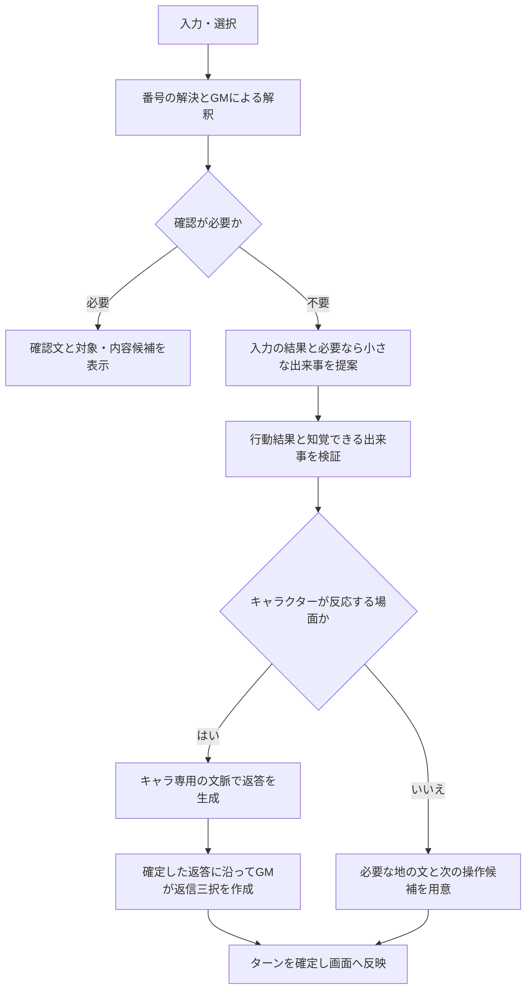

# ゲームモード設計案

状態: 体験設計。2026-10-04。開始時のアドリブ導入、小さな出来事、ゲーム専用の短期記憶を反映。アプリの実装・通常システムプロンプトの変更は行わない。

実装時の型・HTTP契約・状態遷移・保存先・テスト条件は [ゲームモード実装設計](game-mode-implementation-design.md) を参照。具体的な動作は同文書の決定事項に従う。

## 1. 目的と基本方針

入力欄右の「…」メニューにチェック式の「ゲームモード」を追加する。プレイヤーは自由に話しかけることも、コマンドや数字で行動することもできる。裏側のゲームマスター（以下GM）が入力の意味と場面を管理する。開始時には現在の会話を踏まえた短い導入をアドリブで作り、状況説明の後に選択肢を提示する。進行中も小さな出来事やハプニングを加え、会話や行動のきっかけを作れる。

GMは登場人物ではない。画面にはGMの名前・アイコン・内部判断・プロンプトを出さず、説明は無署名の地の文、選択肢は操作用カードとして表示する。キャラクターへ渡すのは実際に聞こえた発言・見えた行動・知覚した状況だけとする。

「GMを知覚しない」は、単に通常プロンプトへ禁止文を追加するのではなく、GMの文脈をキャラクターの入力から分離することで実現する。LLMの発言品質は別途検証が必要であり、情報分離だけでメタ発言が絶対に発生しないと保証するものではない。

## 2. 要望として確定していること

- 「…」内のチェックで有効化・解除する。
- GMはプレイヤーにもキャラクターにも登場人物として見えない。
- 開始時はGMがアドリブで短い状況説明を作り、その後に選択肢を表示する。進行中の追加説明は必要なときに行う。
- 小さな出来事やハプニングで、GMが自然に展開のきっかけを作ってよい。
- キャラクターの発言に沿った返信を三択で提示する。
- 「見る」「話す」など対象不足のコマンドでは、対象を尋ねる文と選択肢を表示する。
- 数字による選択はその内容の発言・行動として扱い、キャラクターへ自然に伝える。
- 自然文が話しかけとして判定された場合、コマンドを要求せずその発言を届ける。
- ゲームの進行・選択肢生成の指示は通常システムプロンプトに含めない。
- 開始時は現在の会話とキャラ設定から舞台・状況を自然に引き継ぐ（ユーザー確認済み）。
- ゲーム中の出来事はゲーム専用の記録に分け、通常の長期記憶には追加しない（ユーザー確認済み）。
- ゲーム専用の短期記憶をセッション中だけ使う。ゲーム中は実効的にプライベートとし、通常のプライベート設定自体は維持する（ユーザーが方向性を了承）。

## 3. 初版の動作

開始場面の引き継ぎ、アドリブ導入、小さな出来事による進行、記録の分離はユーザー確認済み。以下はその方向性を具体化した初版の設計。

| 項目 | 動作 |
| --- | --- |
| 開始場面 | 現在の会話とキャラ設定を引き継ぎ、GMが2〜3文程度の導入を即興で作る。設定に合う身近な物や小さな出来事を足し、地の文で示してから三択を提示する。大きな事件・勝利条件は勝手に追加しない |
| 進行のきっかけ | 会話の一区切りや展開が停滞した場面で、小さな出来事を一つ加えられる。毎ターン必須にはせず、自由入力で別の展開を選べる |
| 記憶 | ゲーム専用のRAMに現在の状態・重要事実・視点別要約・直近の会話を保持。通常の長期記憶には追加しない。記憶設定ONなら開始時の既存記憶を参照可能 |
| プライベート | ゲーム中のみ実効ON。通常のユーザー設定は変更せず、解除時は元の設定で動く |
| 解除後 | 開始前の通常会話へ戻る。ゲーム中の出来事は通常履歴へ自動転記しない |
| 同じ会話で再度ON | 中断したゲームへ復帰する。通常会話で増えた内容は途中のゲームへ自動混入させない |
| キャラ変更・通常ログ読込・人格再適用 | ゲームを終了してRAMの短期記憶を破棄。別の通常セッションへ流用しない |
| ページ終了・リロード・アプリ再起動 | ゲームを終了。自動でONにしない。終了通知が届かない場合のRAM回収はリース失効で行う |
| 公開ログ | 既存のログ保存設定に従う。プレイヤーに表示した内容だけ専用形式で保存できる。ゲーム復元用の記憶ではない |
| 音声 | キャラクターのセリフのみ既存TTSを使用。地の文・選択肢・確認文は読み上げない |
| GM用モデル | 当初は設定済みLLMを別リクエスト・別履歴で使う。別モデルの設定UIは後続で検討 |

OFFは同一セッション内の中断、ページ終了やキャラ再選択は終了と区別する。保存済みの公開ログはゲーム終了で削除しない。

## 4. 画面と操作

メニューの「自動応答」付近に「☐ ゲームモード」を置く。ON中は「☑ ゲームモード」。チェック状態はサーバーの開始成功後に確定する。入力欄付近にも小さく「ゲームモード」を表示し、現在の入力の扱いが分かるようにする。

初めてONにすると、GMが現在の場所・話題・キャラ設定から短い導入を作り、必ず先に地の文で状況を説明する。そこに自然な反応があればキャラ本人の発言を生成し、その発言に沿った返信三択を出す。キャラが話す必要のない導入では、状況に沿った行動三択を直接出してよい。開始のためだけに挨拶を繰り返したり、プレイヤーを勝手に移動・発言させたりしない。

中断からの再ONでは、現在の場面を短く説明して有効な選択肢を再表示する。ONにするたびに別の導入や新しいハプニングを発生させない。

キャラクターは既存の吹き出し、地の文は中央寄せなどの控えめな独立表示、選択肢は最新位置のカードで区別する。生成待ちの表示は「状況を確認中…」などにし、GMという名前を表示しない。

```text
窓の外では雨が降り始めた。

キャラクター: 雨、強くなってきたね。もう少しここにいようか。

  1  「うん、少し雨宿りしよう」
  2  「雨の音って、けっこう好きなんだ」
  3  「止むまで何をして過ごそうか」

[ 話しかける、行動を書く、数字で選ぶ…              ][送信][…]
```

各選択肢はクリック・タップも可能。数字入力と同じサーバー処理を通す。自由入力は常に可能で、選択肢を選ぶ義務はない。確認待ちでも「窓を見る」「雨は好き？」のような新しい具体的入力へ切り替えられる。

返信三択は、直前のセリフへの返答として自然で、立場・関心・話の広げ方に違いがあるものにする。同じ意味の言い換え三つや、未提示の秘密を前提にした返答は避ける。原則として発話の選択肢とし、行動を伴う場合は「窓へ近づき『外を見てくるね』」のように選択前に全内容を明示する。選択肢は生成・表示しただけでは実行されない。

コマンドの対象候補は存在するものだけ提示する。返信は三択だが、対象が二つしかない場合に架空の三つ目を作らない。対象候補の数は可変とし、候補外の対象も自由入力できる。

### アドリブ導入と小さなハプニング

GMは既存の事実を土台に、まだ決まっていない周囲の様子や小さな出来事を補う。例えば、部屋での会話中なら「開いた窓から風が入り、机のメモが床に落ちる」、外を歩いているなら「近くから焼きたてのパンの香りがする」。場所・時刻・直前の話題と矛盾する転換はしない。新しく登場させる物は状況説明に含め、説明のない対象を選択肢だけに出さない。

導入例（部屋で会話している場合）:

> 窓から入った風が、机の上のメモを床へ落とした。紙はあなたたちの間で止まっている。
>
> キャラクター: あ、飛んじゃった。そこまで行くとは思わなかったな。
>
> 1. メモを拾って「これ、何のメモ？」と尋ねる。
> 2. 「風が気持ちいいね」と話を続ける。
> 3. 「窓、少し閉めようか？」と提案する。

ここで確定するのは「メモが落ちた」という出来事まで。プレイヤーが拾う・窓を閉めることや、メモの内容への反応は選択前に確定しない。3番も閉める行動ではなく提案の発言。キャラのセリフはGMが代筆せず、知覚した出来事からキャラ本人が生成する。

進行中は次の方針で出来事を挟む。

- 会話が一区切りした、同じやり取りが続いた、プレイヤーが周囲を調べた、といった自然なタイミングを使う。盛り上がっている会話や質問への返答を遮らない。
- 一度に加えるきっかけは一つ。直近の出来事とその後の反応を記録し、同じハプニングの反復や連続投入を避ける。具体的な間隔は会話評価で調整する。
- 出来事は興味を引く材料として使い、無視する・断る・今の話を続ける余地を残す。無視された出来事を強引に再提示したり、大きな事件へ発展させて従わせたりしない。
- 世界の変化はGMが作れるが、プレイヤーの行動・感情・同意やキャラの感情を代わりに決めない。
- 出来事は開始時または入力が確定したターン内で扱う。対象確認中・番号間違い・空欄・再試行・入力待ちの経過時間だけでは新しい出来事を起こさない。無操作時の自動進行は別仕様とする。

## 5. 入力の解釈

| 入力例 | 処理 | キャラクターに渡す内容 |
| --- | --- | --- |
| `2` / `２` | 現在の有効な候補の2番をサーバーで解決 | 選択した発言・知覚できる行動。数字や選択操作は渡さない |
| `見る` | 対象不足なら「何を見ますか？」と対象候補を表示 | まだ何も渡さない |
| `話す` | 対象が複数なら「誰に話しかけますか？」。一人なら内容候補へ進む | 対象選択だけでは発話を作らない |
| `窓を見る` | 窓があるか・見えるかを判定し、必要な描写を表示 | キャラから見えた行動だけ。窓の外の詳細もキャラが見える場合のみ |
| `今日は何をしていたの？` | GMがキャラへの発話と判定 | 原文の発話をそのまま渡す |
| `窓に近づいて「雨だね」と言う` | 行動と発話を一つのターンとして解決 | 実行できた移動と、聞こえた発話 |
| `あれを調べる` | 指示先が曖昧なら確認と候補を表示 | 確認が終わるまで渡さない |
| `キャンセル` | 現在の対象・内容選びを解除し、前の返信候補を復元 | 渡さない |
| 空欄 | 現在の候補を再表示。待機や行動を勝手に実行しない | 渡さない |

優先順は、既知の選択操作 → 明確なコマンド → GMによる自然文の発話・行動・確認判定。単語の部分一致でコマンドにしない。「映画を見るのが好き」は発話として扱える。

数字だけの入力は選択専用。有効な候補がない・範囲外の場合は短く案内し、発話にも行動にも変換しない。数字そのものを話したい場合は `「2」` または `2と答える` と入力できる。引用された「見る」「キャンセル」もコマンドとして消費しない。

「話す」の流れは対象選択と発話内容選択を区別する。例: `話す` → 相手を選ぶ → 言いたい内容の三択 → `2` → 初めて発言が実行される。途中で直接セリフを入力した場合は、その内容で進める。

## 6. GM・キャラクター・アプリの責務

| 担当 | 責務 | 担当させないこと |
| --- | --- | --- |
| GM | アドリブ導入、小さな出来事の提案、入力意図、必要な確認、場面と行動結果の提案、地の文、確定したキャラ発言に対する返信候補 | プレイヤーが選んでいない行動を実行すること、キャラのセリフや内面を勝手に確定すること |
| キャラクター | 口調・性格を守り、自分が知覚した発話や行動へ反応する | 番号・コマンド・候補の管理、GMの解説、知らない場所や隠れた行動への反応 |
| アプリ | 選択番号の解決、対象IDの存在・可視性チェック、状態の確定、順序制御、表示と音声の振り分け | LLMの出力した状態更新を無検証で実行すること |

GMが管理する事実には知覚者を持たせる。プレイヤーしか見ていない内容、キャラクターだけが知る設定、双方が知覚した出来事、まだ公開していない世界情報を分ける。プレイヤー向け地の文にもキャラクターの秘密や内心を漏らさない。

選択した行動は、実行可能なら実際に起きたものとして確定する。自由入力で不可能なことを要求した場合は「試みたが起きなかった」など場面と整合する結果を返す。キャラクターが離れた場所にいる・視線が届かない場合は反応を無理に生成しない。

キャラクターの発言は「発言があった」という事実として記録する。噂・推測・嘘・提案を無条件に世界の確定事実へ昇格させない。

## 7. ターンの流れ



通常はGMの解釈 → キャラクター返答 → GMの返信候補で3回程度のLLM生成になる。確認だけなら原則1回。要約・修復が必要なら呼び出しは増える。確定済みの発話候補を選んだ場合は再分類を省けるが、行動結果や出来事の解決が必要ならGMを通す。意味的に依存する生成を並列化せず、三択が実際のキャラ発言とずれないことを優先する。

開始時はGMの導入生成 → 必要なキャラ反応 → 選択肢生成の順にする。進行中の小さな出来事は入力解釈・行動結果を提案する段階に含める。返信候補を作る最終段階で新しい出来事を追加するとキャラが未認識のままになるため、その段階では場面を変更しない。選択済みの発言・行動を先に尊重し、出来事でその意味をすり替えない。

初版はターンの出力を一度バッファし、構造・視点・整合性を確認してから一括JSONで表示へ渡す。TTSは確定したキャラ発言に対して別途要求する。生成途中のGM JSONや未確定のセリフを読み上げない。生成時間は通常チャットより長くなるため、画面には生成待ちの表示を出す。後続の改善として、確定済みキャラ発言を先に出して三択を追送する方式を検討できる。

## 8. モジュールとインターフェースの案

専用の `game_mode` モジュールに、GM呼び出し・候補管理・状態遷移・知覚情報の構築をまとめる。画面や通常チャット側に個別のゲームルールを広げない。

外部インターフェースは次の操作を基本とする。具体的な引数・結果は実装設計に定義する。

- `start` / `resume` — 新規開始と中断状態への復帰を分ける。返すのはゲームIDとプレイヤー向け表示。
- `submit(game_id, revision, request_id, input)` — 一回の入力を処理し、確定した表示と新しい版を返す。
- `suspend(game_id)` — ゲームの入力受付を止め、中断状態を保持する。
- `close` / `view` — 終了による短期記憶の破棄と、公開状態の参照。

LLM・音声生成・保存処理は既存の接続設定を使う処理として渡せる形にし、状態更新の検証は外部LLMなしでもテスト可能にする。HTTPでは開始・ターン・中断などの専用ルートへ対応させ、通常の `/chat` と分ける。初版はストリームにせず、公開イベントの配列をJSONで返す。

保持する最小データ:

| データ | 内容 |
| --- | --- |
| `GameSession` | ゲームID、キャラID、版、モード状態、開始時の通常会話と設定のスナップショット |
| `SceneState` | 場所、登場人物、見える対象、確定した出来事、知覚範囲、直近に導入した出来事とその反応。必要なら時間や所持品 |
| `PendingInteraction` | 返信／行動／対象確認／内容選択の種別、確認文、候補ID、対象ID、正確な発話・行動、生成時の版 |
| `CharacterHistory` | キャラ本人の発言と、キャラが知覚した出来事のみ |
| `PlayerTranscript` | プレイヤーに表示した地の文・操作・選択内容・キャラ発言 |

`1`などの番号と実際の候補IDの対応はサーバーで保持する。ブラウザが送る候補本文は実行根拠にしない。新しい候補が提示されたら過去の候補は無効にする。古い番号カード、連打、別タブからの操作はゲームID・版・リクエストIDで区別する。

GM出力は構造化された決定のみとし、長い思考過程を要求・保存しない。概念上は `intent`、`clarification`、`proposed_events`、`player_narration`、`choices` を持つ。型、件数、参照先、知覚範囲、候補と場面の整合をアプリ側で検証する。JSON生成機能を持たない接続先でもテキストJSONを検証し、不正なら一度だけ修復を試す。

`proposed_events` はプレイヤーが選んだ行動の結果と、GMが導入する環境の出来事を区別する。GMが物を新しく登場させる場合はその追加と知覚範囲も提案し、既存設定との整合を検証してから場面へ登録する。選択肢の対象チェックは追加後の場面に対して行う。採用した出来事・対象・描写・候補は同じターンとして確定し、再送で二度発生させない。

キャラへの入力例は「相手が窓へ近づき、あなたに『雨だね』と言った」。GMという送り手、番号、選択肢一覧、行動の分類理由、プレイヤーだけに見せた説明を付けない。

## 9. プロンプトと履歴の分離

通常の `prompts/base_system_prompt.txt` は変更しない。通常のプロンプト選択リストにもGM用ファイルを出さない。現在は `prompts/` 直下の `.txt` が一覧に載るので、GM指示は `game_mode/prompts/` など別の場所に置く。

- GM専用の入力: アドリブ導入と小さな出来事の進行方針、場面状態、GMが参照可能なキャラ設定、直近の出来事と発言、現在の入力。選択肢生成時には確定した最新のキャラ発言を渡す。
- キャラ専用の入力: 通常の人格・発話ルール、キャラ設定、ゲーム内で知覚した履歴。ゲームで必要な知覚情報の解釈だけを専用処理で補う。GMの存在や三択の生成指示は一切含めない。
- 通常会話の入力: 従来どおり。ゲームの選択待ち状態やGMの指示を混ぜない。

同じモデルを使っても別メッセージ列・別履歴で呼ぶ。キャラに「GMの存在を知っているが秘密にして」と教える方式は採用しない。人格設定内の情報も、GMが知っていることとプレイヤーへ公開してよいことを区別する。

通常の長期記憶の抽出対象に、ゲームの地の文、候補、入力した数字を入れない。ゲーム中の発話・行動も専用の短期記憶に留める。プライベートモードとログ保存は既存UI上の意味を区別する。現在のプライベートモードは長期記憶への追加抑制であり、ログ保存OFFを意味しないため、保存の可否は別途その設定に従う。

## 10. 既存コードとの接続点

確認した現状に対する変更候補。今は編集しない。

| 現在の場所 | 実装時の方針 |
| --- | --- |
| `index.html` の `menuDefs` | チェック式メニュー項目と状態表示を追加 |
| `sendMessage()` | 通常／ゲームの送信先を分岐。ゲームでは応答前にキャラ吹き出しを作らず、実際のイベント種別に合わせて描画 |
| ゲーム専用のJSON描画 | 確認・地の文・三択をキャラ発言と区別する。通常の `consumeStream()` へ流さない |
| `/chat` | 通常処理を保持。ゲームの入力を通常履歴に追加しない |
| `stream_llm_with_tts()` | 現状はグローバル `state.selected` と `state.memory` に依存するため、ゲームから呼ばない。初版は通常SSEを維持し、LLMの接続設定と低水準TTS処理だけ共有する |
| `_build_llm_messages()` | 現状の日時・通常記憶の付加をゲームへ無条件に流用しない。ゲームの場面・ゲーム内時間と矛盾しない専用文脈を作る |
| 通常ログ | 現状はUSER/ASSISTANT中心。ゲーム記録には専用の型と版を設け、通常ログ読込で地の文をキャラ発言へ変換しない |

ゲーム中は自動応答を停止する。プレイヤー役を自動生成すると、本人が選ばないまま行動が確定するため。直接TTS、シナリオ再生、テキスト読み上げとの同時実行も初版では不可。通常のキャラ音声再生は利用可能。ON/OFFの切り替えで自動応答を勝手に再開しない。

生成中は切り替え操作を無効にし、キャラ変更・解除時にはゲームに紐づく古い表示更新や音声再生を止める。開始失敗ならOFFのままとし、通常会話の状態は維持する。再ONでは保存された有効候補も含めて復帰する。

## 11. 失敗時の扱い

- GMのJSON不正・タイムアウト・整合性不良: 一度の修復後も失敗したら短いエラーと再試行を表示。行動や履歴を確定しない。
- キャラ生成や三択生成の失敗: 初版の一括確定方式ではターン全体を未確定に戻す。エラー文をキャラのセリフとして発声しない。
- 応答喪失後の再送: 同じ `request_id` は確定済みの結果を返し、プレイヤーを二回行動させない。
- 音声生成だけ失敗: 確定したテキストを保持して音声のみ再試行可能にする。行動を再実行しない。
- 非公開情報や「選択肢」「GM」への不自然なメタ言及: 出力を表示・発声する前の検査対象とする。単語の全面禁止ではなく、場面内で自然に話題にしている場合と混同しない。モデルごとの会話評価も必要。

## 12. 受け入れ確認

1. OFF時は通常会話のプロンプト・履歴・送信の振る舞いが変わらない。
2. 初回ON時にGMという発言者を表示せず、会話と設定を引き継いだ短い導入を必ず表示してから三択を出す。キャラの発言があれば返信三択、なければ場面に沿った行動三択にする。
3. キャラが「雨宿りしよう」と言った直後の三択がその発言に対応する。
4. `2`は表示済みの内容を一回だけ実行し、キャラ入力に番号や候補一覧が含まれない。
5. `見る`では対象確認だけが出て、勝手な行動・キャラ返答・時間経過が起こらない。
6. `話す`の対象選択だけでは発話が発生せず、内容が決まってから相手に届く。
7. 「雨は好き？」はコマンドを要求されず、自然な発話として伝わる。
8. 候補提示後も自由入力で話題・行動を変えられ、古い候補は無効になる。
9. キャラから見えない調査結果にキャラが反応せず、GMだけが持つ情報が双方へ漏れない。
10. 返信三択は表示だけでは行動にならず、隠れた追加行動も発生しない。
11. 通信再送・連打・古い版の操作で重複した行動や記憶が作られない。
12. OFF・キャラ変更後に遅れて届いたゲームの返答や音声が混ざらない。
13. 通常の長期記憶とプロンプト一覧へGM指示・ゲーム記録が混入しない。
14. 選択肢・地の文をキャラの声で読み上げず、音声再試行でゲームが進まない。
15. 新しく登場した物や小さな出来事は描写・場面状態・キャラの知覚が一致し、候補にだけ存在する対象がない。
16. ハプニングを無視して会話を続けられ、選んでいない行動や感情を強制されない。
17. 対象確認・無効入力・空欄・再送・再ONでは新しいハプニングが発生しない。
18. 出来事はキャラの反応生成より前に決まり、三択生成時に場面が後から変更されない。
19. ゲーム前の通常会話の保留中記憶を保持し、ゲーム中のflushでもゲーム情報を抽出対象にしない。
20. 長いゲームでも重要事実と知覚範囲を保持し、通常のプライベート設定はON/OFFで変更されない。
21. 終了時に内部記憶を破棄し、保存済み公開ログから勝手に復元しない。

## 13. 実装へ進む場合の順序

設計確認後に、専用状態と入力解決 → 「…」の切り替えと表示 → GM判定とキャラ知覚の分離 → 三択とコマンド → 既存モードとの排他・音声・記録の順で進める。まず一つのキャラクターとの会話・観察を成立させ、戦闘・ステータス・複数NPC・シナリオ作成画面は別途要望が出てから設計する。
