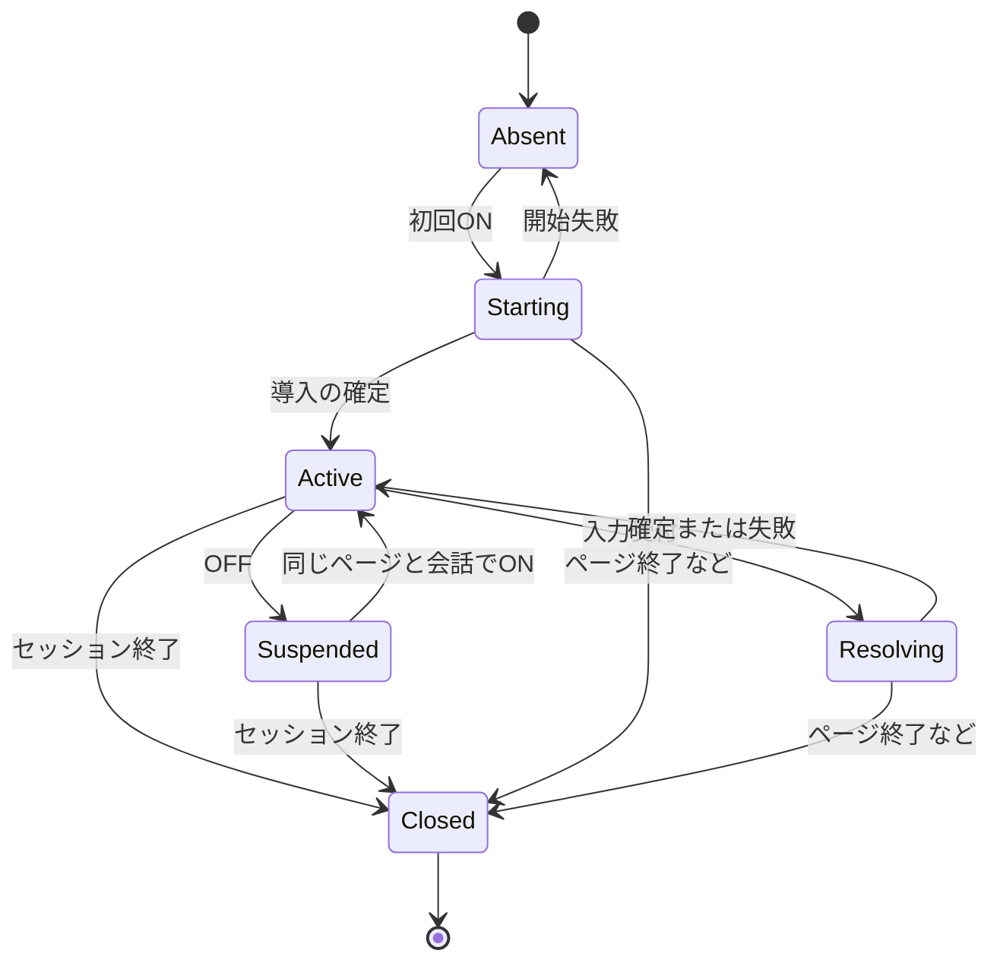

# ゲームモード実装設計

2026-10-04。設計のみ。体験の背景・画面例は [ゲームモード設計書](game-mode-design.md) を参照。本書は初版の実装時の判断基準であり、先行案の未確定事項を具体化する。以下の定数・HTTPパス・ファイル名は新設案であって、現時点では存在しない。

## 1. 初版の決定事項

- 「…」のゲームモードをONにすると、現在の会話・人格・関係性を引き継いで即興の導入を作り、短い状況説明、必要なキャラ反応、三択を順に表示する。
- 発話・行動の自由入力、番号選択、対象確認を扱う。GMは小さな出来事を加えられる。キャラ発言がある場合の三択はその発言に沿った返信とする。
- ゲーム専用の短期記憶をサーバーRAMに持つ。通常会話の履歴・長期記憶・親密度・セッション回数へゲームを反映しない。
- 記憶は「現在の状態」「視点ごとの要約」「直近のターン」で構成する。表示ログは別に保持する。
- ゲーム中は実効的にプライベート。ユーザーが選んでいた通常のプライベート設定は変更しない。
- OFFは中断。同じページ・同じ通常会話セッションでONに戻すと再開する。ページ終了、リロード、キャラ再選択、通常ログ読込、人格プロンプト再適用はゲーム終了とする。
- 終了したゲームの内部状態をディスクから復元する機能は初版に含めない。保存ログは閲覧用で、セーブデータではない。
- ログ自動保存は既存の `log_auto_save` 設定に従う。保存対象はプレイヤーに実際に表示した内容だけ。GMの秘密・内部状態・要約は保存しない。
- 現状のアプリが一つのグローバル `AppState` を持つことに合わせ、同時に保持するゲームは一つ。同一会話を複数ユーザーが同時進行する対応は行わず、競合は明示的に拒否する。
- 初版のゲーム応答はJSONで一括返却する。生成途中のテキストは表示・発声せず、確定後にキャラ発言だけ既存TTSへ渡す。通常チャットのSSEは維持する。

## 2. セッションと状態遷移

### 2.1 識別子

| 名前 | 所有者・意味 |
| --- | --- |
| `page_id` | ページ読込ごとにブラウザメモリで作るUUID。localStorage/sessionStorageへ保存しない |
| `conversation_epoch` | サーバーが通常会話の初期化時に更新するUUID。キャラ再選択・プロンプト再適用・ログ読込による表示セッション変更で更新 |
| `normal_revision` | 通常の発言・返答が履歴へ確定するたびに増やす整数。ゲーム開始時のスナップショット競合を検出 |
| `game_id` | サーバーが作るUUID。終了後に再利用しない |
| `revision` | ゲームの候補や状態が変わるたびに増やす整数。確認の表示でも増える |
| `world_turn` | 世界内の発話・行動・出来事を確定した回数。確認・再表示・中断では増えない |
| `request_id` | クライアントが論理的な操作ごとに作るUUID。通信再送では同じ値を使う |
| `interaction_id` / `choice_id` | サーバーが候補セット／個々の候補に付けるID。番号はセット内の表示順にすぎない |

`page_id` は競合識別用であり認証ではない。初版は既存のローカル利用・アクセス制御を引き継ぐ。

### 2.2 状態



候補待ちは `Active` 内の `PendingInteraction.kind` で表す。状態名と入力待ちの種類を一つのenumへ混在させない。

### 2.3 操作の結果

| 操作 | 結果 |
| --- | --- |
| 初回ON | 通常生成が停止していることを確認し、サーバー上の現在の人格・通常履歴・参照可能な長期記憶をコピーして開始 |
| OFF | `Suspended`。音声と表示更新を停止。通常のDOM・入力下書き・ログセッションを復帰。通常履歴は書き換えない |
| 再ON | 同じゲームの短い状況要約と有効候補を再表示。新しい出来事・再挨拶・重複ログを作らない |
| 中断中の通常会話 | 通常のプライベート設定で会話できる。ゲームのスナップショットや知識には反映しない |
| キャラ変更・再選択 | 旧ゲームを終了して通常の選択処理へ進む。同じキャラの再選択でも新しい通常セッション扱い |
| 通常ログ読込・プロンプト再適用 | 成功時に旧ゲームを終了しepochを更新。ゲーム中はこれらの操作をUIで無効にし、OFF後に操作する |
| `pagehide` | page_idによるゲーム終了をbeaconで通知。開始応答前の予約も取り消す。既存の通常記憶flushは維持。両処理は互いのデータを参照しない |
| ブラウザの戻るでページ復元 | `pageshow.persisted` ではゲーム状態を破棄し、通常状態を再同期。終了したゲームをDOMだけで復活させない |
| サーバー停止・再起動 | RAMのゲーム状態は失われる。次のアクセスでOFFへ戻し「ゲームのセッションが終了しました」と表示 |

ページ終了の通知は保証できないため、終了失敗分の回収にリースを使う。ゲームが中断中でもページが生きている限り60秒ごとに更新、30分更新がなければサーバー側で破棄する。失効判定は各アクセス時と60秒周期の清掃で行う。長時間ブラウザが休止した場合も終了し得るので、復帰時は必ず状態確認する。入力しないだけではハプニングを起こさない。

初版では別ページから保持中ゲームを奪わない。別ページからの開始・キャラ変更などは409とし、元のページで終了するかリース失効後に再試行する。終了通知を受けたgame_idの小さな終了記録とrequest_idは5分だけ残し、遅延した開始・ターン要求で再生成しない。終了記録には会話本文を持たせない。

## 3. プライベート動作と通常記憶の保護

ブラウザの `privateMode` は通常モードのユーザー設定として維持する。

```text
effectivePrivate = privateMode OR gameState in {Starting, Active, Resolving}
```

ゲーム中のメニューは「✓ プライベートモード（ゲーム中）」、切り替え不可。説明は「ゲームの出来事は通常の記憶に追加しません」。OFFでは表示も元の `privateMode` へ戻る。中断したゲームがRAMに存在しても、通常会話の保存を止めない。

保存禁止はサーバーにも実装する。ゲーム要求に `memorize` を設けず、ゲームの処理から `_record_memory_turn`、`_touch_memory_turn`、`_begin_session`、`_schedule_memory_update`、`save_memory` を呼ばない。クライアントが `memorize: true` を混ぜた場合は余分なフィールドとして422にする。

`state.memory`、`state.mem_pending`、`state.mem_user_turns`、`state.session_ctx` をゲーム開始・中断・再開時に入れ替えたりクリアしたりしない。ゲーム前の通常会話に由来する保留中の記憶抽出は、そのまま実行・保存してよい。「ゲーム中に長期記憶ファイルが全く書かれない」ではなく「ゲーム由来の情報が保存されない」が不変条件。

開始時の長期記憶読み込みは `memory_enabled` に従う。OFFなら読まず、人格と通常の短期履歴のみ使う。ONなら開始時に一度コピーし、その後のゲームはライブの記憶ファイルを再読込しない。ゲーム内で生じた約束・印象はゲームだけで保持し、通常の親密度の数値は更新しない。

引き継ぐ通常履歴はサーバーで保持している直近12往復・最大24,000文字を上限にし、完全な往復単位で選ぶ。通常履歴自体は削らない。GMにはこの文脈と参照用のキャラ設定から矛盾のない導入を作らせる。人格プロンプト単体で接続先の上限を超える場合は開始エラーにし、人格を無断で切り詰めない。

## 4. サーバー内部のデータ契約

実装時はPydanticモデルを使い `extra="forbid"`、文字列長・件数・enumを検証する。以下は設計上の型であり、公開レスポンスではない。

| 型 | 必須項目 |
| --- | --- |
| `GameSession` | `game_id`, `owner_page_id`, `conversation_epoch`, `status`, `revision`, `world_turn`, `seed`, `scene`, `memory`, `pending`, `base_choices`, `request_records`, `public_transcript`, `lease_expires_at` |
| `GameSeed` | 安定したキャラID（プロンプトの正規化パスなど。UIのindexを使わない）、人格・通常システムプロンプト、通常履歴のコピー、読み取った長期記憶、開始時の時間情報、キャラ画像・音声参照 |
| `SceneState` | `location`, `scene_time`, `entities`, `facts`, `hooks`, `last_hook_world_turn` |
| `Entity` | `id`, `name`, `kind`（place/person/object）, `location_id`, `perceived_by`（player/characterの集合）, `description_by_view` |
| `Fact` | `id`, `text`, `known_by`, `source_event_ids`, `status`（current/superseded）, `supersedes_id?` |
| `WorldEvent` | `id`, `world_turn`, `source`（player/environment/character）, `kind`（speech/action/observation/environment）, `actor_id`, `target_ids`, `text_by_view`, `outcome`（occurred/failed_attempt）, `source_input_id?` |
| `GameMemory` | `gm_summary`, `character_summary`, `recent_turns`, `important_facts`, `unresolved_threads`, `summarized_through_turn` |
| `SummaryItem` | `text`, `source_event_ids`。視点ごとの入力から別々に作る |
| `Hook` | `id`, `event_id`, `introduced_turn`, `status`（open/engaged/ignored/resolved）, `topic_key` |
| `PendingInteraction` | `id`, `kind`（reply/action/target/content）, `prompt?`, `command?`, `target_id?`, `choices`, `revision` |
| `Choice` | `id`, `ordinal`, `label`, `selection`。labelと実際の行動は同じ構造データから構成 |
| `Selection` | `kind`（select_target/perform）, `target_id?`, `steps`（発話・行動の順序付き配列） |
| `Step` | `kind`（speech/action）, `text`, `target_id?`。発話は実際に言う文字列、行動は試みる内容 |
| `RequestRecord` | `request_id`, `payload_hash`, `status`（running/committed/failed）, `response?`, `started_at` |

IDはアプリが採番する。GMが出す新規対象は一時キーで参照させ、検証後にIDを割り当てる。既存対象のIDを勝手に再定義させない。候補は未来の入力であり、FactやWorldEventとして記憶・要約しない。

### 4.1 知覚情報

GMは検証用の全場面を参照できる。キャラ入力は `text_by_view.character` とcharacterが知るFactだけ、公開描写は `text_by_view.player` だけで組み立てる。対象が見えない場合も、音で知るなどの理由があれば対応する知覚文を作れる。

GMからの自由文をそのままキャラのsystemへ連結しない。人物・物の説明、ユーザー発言、知覚イベントをデータとして囲み、キャラ用の固定指示で「見聞きしたこととして受け取り、本人の言葉で反応する」と示す。固定指示にもGM・番号・ゲームの内部処理という語を教え込まない。

初版では秘密の内容を含むテキストをキャラ用要約生成の入力に一度も渡さない。全体要約を作ってから秘密だけ消す方式は使わない。プレイヤー向け選択肢の生成もプレイヤーに公開済みの場面・発言から行う。

### 4.2 記憶の長さ

初期値: 直近12世界ターン、24,000文字を超えたら古い側を要約し、直近6ターンを残す。各視点の要約は最大2,000文字。これらは内部定数として開始し、設定UIは増やさない。

重要な事実（現在地・所持品・知った情報・未解決の約束）はSceneStateの構造データとして保持し、要約で置き換えない。古い会話の細部を要約する際も `source_event_ids` を持たせ、元にない事実や見ていない出来事を検出しやすくする。参照IDの検証で意味の正しさまで保証できるわけではなく、モデル会話評価も必要。

要約はターン確定前、投機的なコピー上で生成する。失敗時は元データを保持し、合計プロンプト用データが48,000文字以下ならそのターンを継続して次回再試行。それを超える場合は `MEMORY_COMPACTION_FAILED` としてターンを未確定にする。無言で過去を切り捨てない。使用モデルのコンテキスト上限に合わない場合は `CONTEXT_LIMIT` を返し、未確定入力を保持する。文字数はトークン数の保証ではない。

終了までのイベント台帳と表示記録はRAMに保持するが、毎回LLMに全文を送らない。初版の上限は500世界ターンまたは専用RAM記録のUTF-8 JSON換算5MiB。超える入力は確定前に拒否し、ログ保存と通常モードへ戻る案内を出す。ログを書かずに上限を回避する処理は行わない。

## 5. 入力解決とGM生成の契約

### 5.1 正規化・確認

1. 空白のみは候補再表示。整数だけは全角数字をASCIIへ正規化して現在の候補へ照合する。
2. クリックは `interaction_id + choice_id` で解決する。数字の送信にも表示時の `interaction_id` を付ける。
3. 完全一致の `見る`、`話す`、`キャンセル` はコマンドとして解釈。引用符で囲まれた語や文章中の語は一致させない。
4. その他の文章はGMへ渡し、発話、行動、両方、対象不足のいずれかに分類する。キャラ宛ての発話は原文を保存し、勝手に言い換えない。
5. 対象不足は `PendingInteraction` のみ更新し `revision` を増やす。世界ターン・キャラ記憶・ハプニングは進めない。

対象候補はその視点で見聞きできる登録済み対象から列挙する。ゼロ件なら「今、見る対象を特定できません」などの案内と自由入力を許可する。一件なら `見る` はその対象を扱えるが、`話す` は発話内容選択へ進め、セリフを自動実行しない。

確認のネストは一つまで。新しい曖昧入力では今の確認を置き換える。最後に確定した返信／行動三択を `base_choices` に残し、キャンセルはそこへ新しいinteraction_idとrevisionで戻す。空欄や番号範囲外は状態を変えない。

### 5.2 LLMの役割別出力

| 呼び出し | 入力 | 出力と制限 |
| --- | --- | --- |
| `gm_opening` | seed、引き継げる場面情報 | 導入の場面追加・出来事・2〜3文の地の文・キャラが知覚するイベント。プレイヤーの行動を作らない |
| `gm_resolve` | 現在の状態、視点別記憶、入力／解決済みSelection、hook追加の可否 | `clarify` または `resolve` の判別可能なJSON。確認と世界変更を同時に返さない |
| `character_reply` | 固定の人格・発話ルール、キャラの要約と直近履歴、今回の知覚イベント | キャラ本人の短いセリフのみ。JSON・地の文・選択肢は返さない |
| `gm_choices` | プレイヤー向け場面情報、直前の確定予定キャラ発言、公開済み対象 | 3個のSelection候補。世界変更・新規対象・新しい地の文は返さない |
| `summarize` | その視点の古い確定イベントと既存要約 | source_event_ids付きSummaryItem。GM視点とキャラ視点は別の入力で生成 |

`clarify` は `command`, `question`, `target_ids` または内容候補を持つ。`resolve` は `player_steps`, `entity_additions`, `fact_changes`, `events`, `player_narration`, `character_should_reply` を持つ。追加・更新・参照可能なフィールドをモデルで限定し、任意のdict patchを受け付けない。

`player_steps` は元の入力／Selectionと照合する。対象選択を歩行へ変える、「窓を閉めようか？」を窓を閉める行動へ変えるなどの変換は拒否する。意味の曖昧さが残れば確認へ戻す。複合行動は書かれた順に評価し、後段の前提が成立しない場合は未実行にする。

返信候補・行動候補は厳密に3件、対象候補は0〜8件を一画面に表示し、多い場合は「対象名を入力」も案内する。候補ラベルはStepからアプリが作る（発話は「…」、行動はその本文）。別の表示文と隠れた実行文を生成させない。

### 5.3 ハプニング

開始時は最大一つ、進行中は前のhook導入から3世界ターン以上経過し、対象確認中でなく、未処理hookがない場合のみ追加を許可する。これは初期の上限であり、毎3ターン必ず発生させる規則ではない。GMへ `may_introduce_hook` を渡し、falseなのに追加したら検証で拒否する。

前のhookを扱わずに別の会話・行動が2世界ターン続いたらignoredとして再提示しない。出来事として発生した事実は消さない。ユーザーが後で自分から触れた場合は再び扱える。キャラへの質問や進行中の重要な会話がある場合は、追加可能でもGMは見送る。

### 5.4 プロンプト配置と検証

`game_mode/prompts/` にopening、resolve、choices、character-context、summaryの専用指示を置く。通常の `prompts/` 一覧と通常systemは変更しない。GMとキャラの会話履歴を共用しない。

接続先は既存のLLM設定を使うがリクエスト開始時にclient/modelを捕捉する。ローカルモデルの出力に含まれる推論ブロック（`<think>` 等）、コードフェンス、前後の説明文を除去し、最初に対応の取れたJSONオブジェクト（または配列）を採用する（2026-10-30改訂）。接続先が対応する場合は `response_format` によるスキーマ強制を優先し、未対応なら `json_object`、無指定の順で自動降格する。自動再試行を含む呼び出し時間に上限を持たせる。

構造・参照・不変条件の違反はLLM呼び出し一段階につき修復1回まで。成功時の通常ターンは解釈→キャラ→三択の3回程度で、要約・修復があれば増える。総処理時間180秒を初期上限にし、超過は未確定で終了する。番号選択でも行動結果や出来事の解決が必要ならgm_resolveを通す。

GM漏出・知らない情報への反応・入力との意味のずれは、構造検査だけでは完全に検出できない。キャラの出力はメタ形式や候補列挙などの明確な違反を検査し、再生成1回後も不適切なら確定しない。曖昧な語の単純な禁止リストで通常のセリフを壊さない。意味面は後述のLLM評価で確認する。

## 6. ターン確定・競合・再送

1. 短いロック内でowner・epoch・revision・リースを検証し、request_idを予約する。通常生成が進行中なら開始を拒否する。
2. ゲーム状態をコピーし、ロック外でLLM生成と検証を行う。通常の `state` は一切更新しない。
3. 同じゲームへの別の変更要求は409 `GAME_BUSY`。同じrequest_idの再送は202 `REQUEST_RUNNING`。失敗済みも含め、同じIDで異なる本文は409 `REQUEST_ID_REUSED`。
4. 確定前に再びロックし、epoch・status・revision・ownerが変わっていないことを確認する。終了済みなら結果を破棄する。
5. scene、記憶、候補、revision、表示バッチ、request結果を一括でRAMに確定する。確認だけならsceneやworld_turnを変更しない。
6. 公開ログの保存を試行する。失敗してもゲーム確定を巻き戻さず、`log_warning` を返す。再試行で行動を繰り返さない。
7. 確定したJSONを返す。音声生成は別の冪等な要求で開始する。

HTTP切断は処理成功・失敗の判断材料にしない。予約済み処理は期限内で継続し、クライアントは同じIDで結果を確認できる。ユーザーが明示的に再試行するのは、前の要求のfailedが確定した場合だけで、その際は新しいIDを作る。

request結果はゲーム終了まで保持する。成功結果は表示バッチへの参照とし、全文コピーを増殖させない。最大2,000操作（確認を含む）で新規入力を拒否し、勝手に古いIDを忘れて再実行しない。リース更新・状態照会は操作数に含めない。

## 7. HTTP契約

パスはすべて新設案。ゲームがない場合は404、期限切れまたは終了IDは410。外部へ内部seed・scene・summaryを返さず、公開用モデルへ明示的に投影する。

| メソッド・パス | 要求 | 結果 |
| --- | --- | --- |
| GET `/conversation/status` | なし | `conversation_epoch`, `normal_revision`, `busy`, `game_active`。通常履歴や別ページの本文は返さない |
| POST `/conversation/view-reset` | `page_id`, `conversation_epoch`, `normal_revision`, `request_id` | 通常ログの読込が成功した後、表示前に呼ぶ。生成中／Activeなら409。中断ゲームを終了しepochを更新。通常履歴の本文は変更しない |
| POST `/game/start` | `page_id`, `conversation_epoch`, `normal_revision`, `request_id` | 導入を確定したGameView。同一開始IDなら既存結果を返す |
| POST `/game/{id}/turn` | `page_id`, `conversation_epoch`, `revision`, `request_id`, `input` | TurnResult |
| GET `/game/{id}` | query: `page_id` | 最新GameView。状態照会では場面を進めない |
| GET `/game/{id}/requests/{request_id}` | query: `page_id` | running/committed/failedと確定結果。再接続用 |
| POST `/game/{id}/suspend` | `page_id`, `revision`, `request_id` | Suspended。revisionを増やす |
| POST `/game/{id}/resume` | `page_id`, `conversation_epoch`, `revision`, `request_id` | 最新GameView。revisionとinteraction_idを更新するが世界ターンは進めない |
| POST `/game/{id}/close` | `page_id`, `request_id`, `reason` | 204。既に閉じていても同じ結果。beaconでも送れる小さなJSON |
| POST `/game/close-page` | `page_id`, `request_id` | 204。そのページの開始予約・ゲームを終了。game_id未受領でも使える。page_idの終了記録も5分保持 |
| POST `/game/{id}/lease` | `page_id` | 204。失効済みを復活させない |
| POST `/game/{id}/audio` | `page_id`, `event_id`, `revision`, `request_id`, `retry`（既定false） | キャラ音声の `req_id`。同じevent_id・同じ試行の再送では二重投入しない |
| POST `/game/{id}/log/export` | `page_id` | プレイヤー向け専用ログのダウンロード。内部状態を含まない |

`input` は `{"kind":"text","text":"2","interaction_id":"i_7"}` または `{"kind":"choice","interaction_id":"i_7","choice_id":"c_2"}` のどちらか。textは最大2,000文字。自由文でも現在のinteraction_idを付け、数字の誤解決を防ぐ。候補なしはnull。

公開応答例（動作の説明用。IDは例示）:

```json
{
  "game_id": "g_1",
  "request_id": "r_8",
  "status": "active",
  "revision": 8,
  "world_turn": 3,
  "events": [
    {"id": "e_8p", "type": "player", "text": "メモを拾って「これ、何のメモ？」と尋ねる。"},
    {"id": "e_8n", "type": "narration", "text": "紙には買い物の品目が並んでいる。"},
    {"id": "e_8c", "type": "character", "text": "買い物のメモだよ。何か食べたいもの、ある？", "audio_eligible": true}
  ],
  "interaction": {
    "id": "i_8",
    "kind": "reply",
    "prompt": null,
    "choices": [
      {"id": "c_81", "number": 1, "label": "「温かいスープが食べたいな」"},
      {"id": "c_82", "number": 2, "label": "「そっちは何を作るつもり？」"},
      {"id": "c_83", "number": 3, "label": "「一緒に買い物に行こうか」"}
    ]
  },
  "log_warning": null
}
```

確認だけのTurnResultは `events: []` と `interaction.kind: target/content` を持つ。案内文はinteraction.promptに置く。エラーや入力案内はキャラ発言にせず、`notice` として表示できる。数字入力の「2」を発話ログに残さず、確定した選択内容をplayerイベントとして表示する。

GameViewは最新interactionと全公開表示記録（上限内）、status、revision、world_turn、log_warningを返す。開始応答が失われた場合は同じ `/game/start` を再送してgame_idを回収する。画面復元ではevent.idで重複表示を避ける。

制御系もrequest_idの再送を処理する。`view-reset` の結果は通常セッションの操作記録へ5分保持し、再送でepochを二度変えない。サーバー再起動で記録が失われた場合はepoch不一致として最新状態を取得する。入力・進行要求のJSONはContent-Typeを明示し、beaconではapplication/jsonのBlobを使う。

主な失敗コード: `GAME_BUSY`, `OWNER_MISMATCH`, `STALE_CONVERSATION`, `STALE_REVISION`, `INVALID_CHOICE`, `REQUEST_ID_REUSED`, `LLM_TIMEOUT`, `INVALID_MODEL_OUTPUT`, `CONTEXT_LIMIT`, `MEMORY_COMPACTION_FAILED`, `SESSION_LIMIT`, `GAME_CLOSED`。古い版や候補では入力を実行せず、最新表示を取得してプレイヤーに選び直してもらう。モデルの内部出力をエラーメッセージへ貼らない。

## 8. 音声

通常チャットは現在のSSE＋バックグラウンドTTSを維持する。ゲームは確定したcharacterイベントを表示してから、TTSがONなら `/game/{id}/audio` を呼ぶ。キャラ本文はサーバーの確定イベントから取得し、クライアントが任意の本文や音声パスを指定する方式にしない。

既存の `enqueue_tts`、`audio_poll` と音声キューを利用できる。game_id/event_idごとに別のreq_idを発行し、捕捉したキャラ音声・Embeddingを渡す。`finished_audios` の初期化と投入は既存のカウンター規約に従う。音声がない、TTS無効なら要求しない。

`/audio` の再送は進行中の同じreq_idを返す。pollで取得済みの音声はフロントがイベント単位に保持してリプレイする。音声失敗・キャンセル・取得結果を失った場合だけ、明示的な「音声を再生成」で `retry: true` と新しいrequest_idを使える。これはLLMやゲームターンを再実行しない。

中断・終了・キャラ変更ではゲームのpollをキャンセルし、ゲームの待機音声を除き、再生中のゲーム音声を止める。以後届く音声はgame_idとページ内の表示世代で破棄する。通常の音声生成関数が共通設定を読むことは維持するが、別キャラ選択後の `state.selected` から声を取り直さない。

ゲーム音声の生成を開始できるのはActive時だけ。古い発言のリプレイはゲーム表示中に限り許可する。TTS接続設定を変えてもゲームの記憶は変わらず、再生成はその時点のTTS接続を使う。初版では既存のバッチ設定にかかわらず一つの確定したキャラ返答を一つの音声生成単位にし、SSE内の文単位生成はゲームに持ち込まない。

## 9. 公開ログ

現在の通常ログは、グローバル `_log_session` を使いUSER/ASSISTANTとして保存する。ゲームをここへ流すと地の文がASSISTANT扱いになるため、専用の保存処理を置く。

- 自動保存先: `log/game/<game_id>.game.json`。手動保存は公開記録を同形式でダウンロード。保存先パスをGMに選ばせない。
- 形式: `format: "bridgetts.game.transcript"`, `version: 1`, `game_id`, `character_name`, `started_at`, `entries`。
- entry: `id`, `revision`, `time`, `type`（player/narration/character/interaction）, `text?`, `choices?`。interactionには表示済みの番号・ラベルのみ持たせ、実行用の内部構造を入れない。
- 保存するのは公開モデルだけ。seed、元の長期記憶、秘密、内部要約、GMのJSON、エラー時のモデル出力は含めない。
- 自動保存は開始時の導入確定から適用。設定OFFならディスクへ作らず、公開記録をRAMに保持する。
- OFF→ONの設定変更時はRAMの公開記録全体を一度保存。ON→OFF後は追加・上書きを止める。既に保存したファイルは消さない。既存のログ設定UIでの説明を継承する。
- 専用ロックと一時ファイル→置換で公開記録のスナップショットを保存する。確認表示の変化も記録するが、同一request_idの再送や再ONの再表示でentryを増やさない。
- 自動保存エラーではRAMの記録を維持して警告し、次の確定または設定の再適用で再保存できる。終了通知時は設定ONであれば最後に保存を試みるが、ページ終了を恒久的にブロックしない。
- 「ログを保存」はゲーム表示中にはこの公開ログを保存し、OFF後は通常ログの保存へ戻る。ゲーム記録を `logMessageBuffer` へコピーしない。
- 初版の「ログを読み込む」と「シナリオを読み込む」は `.game.json` を受け付けず、「ゲームの閲覧用記録で、会話の復元には使えません」と案内する。専用のゲームログ閲覧画面は初版に含めない。保存ファイルそのものはテキストとして読める。

## 10. フロントエンド

初版は `index.html` 内にゲーム用の状態・関数群を独立したブロックとして追加する。既存が単一HTMLのため、ビルド導入や全画面の再構成はしない。

### 10.1 保持する状態

`pageId`, `gameView`, `gameUiPhase`（off/starting/active/submitting/suspending/resuming）, `gameRequest`, `gameDisplayGeneration`, `normalViewFragment`, `normalDraft`, `gameDraft`, `leaseTimer` を持つ。サーバーの場面・知識・候補の実行内容を複製しない。

通常のメッセージ行はDocumentFragmentへ退避し、OFFで同じノードを戻す。フッターの再生ボタンなどのハンドラを維持する。スクロール用の固定要素は退避しない。通常の `logMessageBuffer`、`logSessionId`、`pendingLogChar` は保持し、ゲーム表示はGameViewだけから描画する。

ゲームの再表示はevent.idで重複排除する。候補カードは最新interaction一つだけ操作可能にし、過去のカードは静的表示にする。テキストは `textContent` で描画し、モデルの出力をHTMLとして解釈しない。

### 10.2 送信順序

`sendMessage()` の最初にゲーム分岐を置く。通常の `triggerLogSession()`、入力クリア、キャラ吹き出し作成、`memorize` 算出より前で分岐する。ゲームの処理を通常の送信処理へ戻さない。

送信開始時に入力・revision・interaction_idを捕捉してrequest_idを作る。確定するまで下書きを保持し、失敗したら元の入力を編集できる。数字選択は確定後の公開playerイベントを表示し、送信前に「あなた: 2」を作らない。

生成待ち表示は「状況を確認中…」。初版は一括JSONのため、内部のLLM段階を進捗率として表示しない。通信が途切れた場合は要求結果を照会し、未確認のまま同じ行動を新しいrequest_idで送り直さない。

### 10.3 メニューと排他

ゲームモード項目はチェック可能なボタン相当とし、`role="menuitemcheckbox"`, `aria-checked` と無効状態を設定する。プライベート項目はゲーム中だけ実効値を表示し、通常の `privateMode` を反転させない。

開始前に自動応答タイマーを止める。すでに自動応答の生成・通常の返答生成・音声生成が動いている場合は開始ボタンを無効にし、完了を待つ。音声の単なるリプレイは開始時に停止できる。ゲーム開始が失敗しても自動応答を勝手に再開しない。

ゲーム中は自動応答、直接TTS、シナリオ再生、テキスト読み上げ、通常ログ読込、人格プロンプト再適用を無効にし、「ゲームモードを解除してから使用」と説明する。メニューのON/OFF・キャラ変更は生成中に無効。ページ終了だけは途中でも終了を通知する。

プライベート表示、入力欄のゲーム表示、候補、音声は一つの状態反映関数で更新する。LLM待ちの例外でも片方だけONにならないようにする。

## 11. 既存コードの変更単位

公開インターフェースは `GameEngine.start/submit/suspend/resume/close/view` と、リース・要求結果・公開ログ・確定音声取得に限定する。下位のモデル判定や候補組立をルート／UIから直接呼ばない。

| ファイル案 | 責務 |
| --- | --- |
| `game_mode/models.py` | 内部型、GMの出力型、公開要求・応答型。不変条件の構造検証 |
| `game_mode/engine.py` | ライフサイクル、入力解決、ターン予約と確定、知覚投影、冪等性。状態はこのモジュールが所有 |
| `game_mode/memory.py` | 視点ごとの要約、重要事実、長さの制御。通常記憶ファイルへアクセスしない |
| `game_mode/llm.py` | 役割ごとのメッセージ列、JSON検証・修復、通常の接続設定を使うadapter |
| `game_mode/transcript.py` | 公開ログのみの保存・出力。通常ログのグローバルセッションに触れない |
| `game_mode/prompts/` | 各役割の固定指示。通常のプロンプト一覧からは見えない |
| `bridge_server_api.py` | GameEngineの生成とFastAPIルート、通常会話からseedを作る処理、通常経路の競合ガード、既存TTSとの接続 |
| `index.html` | メニュー、専用表示、送信分岐、状態同期、プライベート実効表示、音声／ログの送信先切替 |
| `tests/test_game_mode_*.py` | Fake LLM、偽の時計・保存・音声処理でインターフェースから検証 |

GameEngineにはLLM adapter、時計、公開ログwriter、音声adapterを渡せるようにする。Pythonの標準unittestでエンジンテストを実施し、HTTPの結合確認にはFastAPI TestClientを使用する（必要ならhttpxをdev依存に明示）。

### 11.1 生成処理の共有範囲

現在の `stream_llm_with_tts()` は `state.selected` の参照、`state.memory` への追記、通常記憶更新、エラー文のキャラ発声まで含む。ゲームから呼び出さない。LLM接続設定の取得と既存の低水準TTS呼び出しだけを共有し、通常のSSE生成関数全体の汎用化は初版では行わない。

これは先行設計の「生成部分の切り分け」の具体化であり、通常チャット全体を作り直す変更にはしない。ゲームのキャラ生成は明示的なmessagesとキャラ情報を受け取り、テキストを返すだけにする。

### 11.2 サーバーで守る通常経路

ブラウザだけのフラグではなく、通常生成の開始・終了とゲーム開始を同じ短い予約ロックで調停する。生成中にロックを保持し続けない。通常生成は捕捉したepochを返答保存前に確認し、別セッションへ遅れて追記しない。

対象は `/chat`、`/initial_greeting`、`/user_reply_gen` と、状態を変える `/select`、`/update_system_prompt`。ゲームActive/Starting/Resolving中の通常生成は409。Suspended中の通常生成は許可する。ゲーム処理中の人格・キャラ変更も409。通常の `/tts_direct` による生成はActive中に拒否し、ゲーム音声は専用ルートを使う。

フロントの通常要求にも `X-Bridge-Page-Id` と `X-Conversation-Epoch` を付け、保持中ゲームがある場合は通常経路でもownerを検証する。Suspended中に許可する通常会話はそのownerに限る。ゲームがない通常利用ではヘッダー省略を従来互換として許すが、フロントは常に付ける。`/select` の成功応答と状態取得で最新epochを同期する。ゲームActive中のキャラ変更はownerによる非生成時だけ許可し、旧ゲームを閉じてから切り替える。

`/select` と `/update_system_prompt` が成功するときは、関連するゲームを終了してepochを更新する。検証に失敗した要求で元のゲームを破棄しない。通常ログ読込は現状表示だけを変える処理のため、`/conversation/view-reset` を `renderLoadedLog()` 前に呼ぶ（本文のLLM履歴への復元までは変更しない）。プロンプト再適用はゲームOFF時のみ許可する。

通常の記憶flushはゲーム中にも呼べるが、通常の `mem_pending` しか見ない。ゲーム開始時に通常のpendingをflush必須にせず、進行中の記憶抽出とも競合させない。別タブが通常経路でゲームをすり抜けて進めないことを結合テストする。

### 11.3 初期設定・調整値

ゲームのON/OFFやゲームデータをsettings.jsonへ書かない。初版ではモデルを増やさず既存LLMを使う。以下はモジュール内の定数にまとめ、後で実測に基づき変更できるようにする。

| 定数 | 初期値 |
| --- | --- |
| 要求全体の期限 | 180秒 |
| 構造化生成の修復 | 各段階1回まで |
| 生成上限 | opening 800 / resolve 1200 / choices 400 / summary 2500 / character 800 tokens |
| 導入の長さ | 2〜3文、最大300文字 |
| キャラ返答 | 1〜3文、上限600文字。通常の文末・絵文字規約を使用 |
| 選択肢 | 返信・行動3件、対象候補最大8件、ラベル最大160文字 |
| 入力 | 最大2,000文字 |
| 履歴圧縮 | 12ターンまたは24,000文字で要約し、直近6ターンを保持 |
| 視点別要約 | 各最大2,000文字 |
| 記録の上限 | 500世界ターン／2,000操作／5MiBのいずれか |
| hook間隔 | 最短3世界ターン、openは一つまで |
| リース | 更新60秒、失効30分 |

## 12. 実装の順序と完了条件

各段階は同じモジュールのインターフェースを通して確認する。GMの出力に似た細部だけをテストするのではなく、プレイヤーの操作と見える結果・保存先が正しいことを確認する。

| 段階 | 実装範囲 | 完了条件 |
| --- | --- | --- |
| 1 | 型・RAM状態・start/close・通常経路の予約ガード | Fake LLMで導入→終了。通常の履歴・pending・長期記憶に変更なし |
| 2 | 「…」の切り替え、専用表示、JSON要求、実効プライベート | 通常DOM・下書き・設定がOFFで戻り、再ONで同じ場面へ戻る |
| 3 | 数字・対象確認・自由発話・行動の処理 | 「見る」→対象、「話す」→内容、「2」→実行、直接発話が成立 |
| 4 | GM/キャラ/三択のLLM adapterと専用プロンプト | 実モデルで導入と一往復が成立。GM情報がキャラ入力にない |
| 5 | 知覚ごとの記憶・要約・hook | 長いやり取りでも所持品や約束を保持し、秘密を別視点に流さない |
| 6 | 音声・公開ログ・失敗／再送／終了時の処理 | 通信再送で重複せず、ログ・音声失敗で世界を二度進めない |
| 7 | 既存機能の回帰とモデル会話評価 | 以下の必須ケースを満たす。通常モードが従来どおり動く |

### 12.1 自動テストの必須ケース

| 分類 | Given / When / Then |
| --- | --- |
| 元設定の復帰 | privateModeがfalse/true各ケースでON→OFFし、元の値が保たれる |
| 保存禁止 | ゲームの10往復を実行しても通常memory/pending/turns/affinityにゲーム由来の変更がない |
| 保留の保護 | 通常pendingがある状態で開始→ゲーム→flushし、通常の発言だけが抽出対象になる |
| 既存記憶OFF | memory_enabled=falseで開始し、load_memoryが呼ばれず人格と短期履歴だけを使う |
| 開始 | 導入の地の文→必要なキャラ反応→3候補。プレイヤー行動が勝手に増えない |
| 数字 | 全角2とクリックが同じSelectionを実行。キャラ入力には数字・候補一覧がない |
| 対象確認 | `見る`で確認のみ。world_turnとキャラ履歴が変わらない |
| 提案 | 「窓を閉めようか？」を選んでも窓は閉まらず、発話だけが相手に届く |
| 直接発話 | 「映画を見るのが好き」はコマンドにせず原文で届く |
| 入力変更 | 対象確認中の自由文で確認を置き換え、旧候補が無効になる |
| キャンセル | 基本候補を復元するが旧interaction_idは復活せず、世界は進まない |
| 視点分離 | playerだけが見たFactをcharacter入力・要約へ一切渡さない |
| 圧縮 | 閾値を超える会話を要約しても重要Factと未解決約束が残る。失敗時に原文を失わない |
| hook | may_introduce_hook=falseの追加を拒否。未対応・無視したhookが連続しない |
| 古い候補 | 新版の後に旧版の数字・クリックを送ると409で世界が変わらない |
| 二重送信 | 同じIDの再送は同じ結果。異なる本文は拒否。別IDの同時送信はBUSY |
| 失敗 | 各LLM段階の不正・timeoutで候補・世界・記憶が中途半端に確定しない |
| 応答喪失 | サーバー確定後に接続が切れても結果照会で同じイベントを復元し、LLMは再実行しない |
| 開始中の終了 | game_id未受領でclose-pageし、遅れてできた導入が確定しない |
| セッション終了 | close/epoch変更後の結果・音声を破棄。別キャラへ追記しない |
| ログOFF | ディスク書込み0件、RAM表示は残る。手動保存は公開記録だけ |
| ログON | 再送・再ONで重複せず、秘密・要約・生のGM出力がファイルに含まれない |
| 音声 | characterイベントだけ生成し、失敗再生成でゲームターンが増えない |
| 別タブ | owner違いの操作とActive中の通常/chatを拒否。元ページの状態を奪わない |

通常モードの回帰対象は、選択→初回挨拶→チャットSSE→音声poll、プライベート切替、通常ログ保存／読込、自動応答、シナリオ再生、プロンプト更新。今回のガード追加で通常の非競合操作が拒否されないことを確認する。

実装後の実行コマンド案は `rtk proxy uv run --group dev python -m unittest discover -s tests`。HTML内のscriptを一時JSへ抽出して `rtk proxy node --check <temporary.js>` で構文確認し、ブラウザでメニュー・クリック・数字入力・再接続・元画面への復帰を通す。本設計の作成時点ではこれらのコードやテストを追加・実行していない。

### 12.2 実モデルでの会話評価

固定シードの入力例と公開出力・内部の送信先別messagesを確認する。正確なセリフ一致ではなく、次を評価する。

- 部屋／屋外／既存の真剣な話題それぞれで、設定に沿った短い導入になっている。
- キャラの発言を受けた三択が内容に即しており、意味の異なる返答になっている。
- 30世界ターン程度の会話で重要な行動を忘れず、同じハプニングを繰り返さない。
- 見えない行動をキャラが言い当てず、GMや選択肢の管理を話題にしない。
- ハプニングを無視しても自由な会話が続く。誘導のために未選択の行動を実行しない。
- 使用モデルで生成時間・コンテキストサイズ・JSON修復率を記録する。意味の品質問題と機械的な契約違反を分ける。

## 13. 初版で行わないこと

内部状態の永続セーブ・ロード、複数NPCの独立LLM、戦闘や数値ステータス、無操作時の自動進行、GMの別モデル選択UI、ゲーム由来の長期記憶更新、通常会話全体のマルチユーザー化。これらは初版を成立させるための必須条件にはしない。


## 14. 初版の実装調整

既存実装と初版の契約を合わせるため、次の点を具体化した。

- GM の解決出力は任意の世界状態パッチとして受理せず、厳密な JSON 項目とイベント、重要事実、hook、最大 2 件の `entity_additions` に限定した。追加物は既存キーと重複できず、プレイヤー向け narration/hook、キャラクター向け character_event に名前が明記された視点だけへ登録する。ID はサーバーが発行し、キャラクター文脈には各視点で知覚済みの投影だけを渡す。
- ターン API は全 transcript ではなく確定した表示イベントの差分を返す。再送用レコードにはイベント ID と応答メタデータだけを保持し、クライアントが差分を既存 transcript に結合する。開始・表示 API は復帰用 transcript を返す。
- 開始要求の冪等性レコードはゲーム終了まで保持する。失敗した開始の同一 request_id も再生成せず、別 request_id で明示的に再試行する。
- FastAPI の結合テスト用に `httpx` を開発依存へ追加した。ゲーム用依存や通常チャット経路の追加依存は導入しない。

- Fake LLM のエンジン/HTTP テストとブラウザの操作確認は実施した。設定済みモデルで有効な導入を一度確認したが、以降の応答では JSON 契約違反が再発したため、実モデルによる通しの会話品質は未検証とする。

## 15. 表示のストリーミング（2026-10-30）

開始とターンAPIは `?stream=true` でSSEを返す。省略時は従来のJSON応答を維持する。イベントは `phase`（opening/resolve/character/summary/choices）、`character_preview`（返答本文の全体スナップショット）、`result`（検証・確定済みの既存応答）、`error`（コードとステータス）で構成する。

構造化されたGM出力や推論過程、内部記憶はストリームへ流さない。地の文とhookはGM出力の検証後、キャラクター生成前に narration_preview イベントで「未確定」として表示する。キャラクターの返答はLLMから逐次受信し、「生成中・未確定」として表示する。キャラクター再生成開始時には返答のプレビューだけを消し、地の文は維持する。失敗時には両方を破棄する。正式なtranscript・音声要求はresult受信後にのみ作成する。世界状態と記憶は既存のトランザクション単位で確定し、段階別の確定は行わない。

クライアントの切断で生成は再実行しない。バックグラウンド処理は既存の要求IDで完了でき、クライアントは結果照会または同じ開始IDの再照会で復帰する。表示世代が変わったストリームは破棄する。送信キューは有界とし、遅い受信者には古いプレビューを間引くため差分ではなく全体スナップショットを用いる。

生成完了前のイベント受信、日本語UTF-8の分割、再生成、切断後の復帰、失敗時の未確定表示破棄、確定の冪等性を自動テストで確認。ローカルLLMからの返答本文のストリーミング受信も確認した。音声自体のストリーミング生成・再生は対象外。

## 16. 非力なローカルLLM向け調整（2026-10-30）

小型のローカルモデルで「進行が遅い」「JSON契約違反で進めない」が頻発したため、契約の意味を変えずに呼び出しの耐性と速度を改善した。

- 解析: `<think>` 等の推論ブロック、コードフェンス、前後の説明文を除去し、最初の対応の取れたJSONを採用する。キャラクターの返答でも推論ブロックを除去し、未終端の推論中はプレビューに流さない。
- 寛容な正規化（`output.coerce_model_output`）: 未知フィールドの除去、文字列真偽値・`null`文字列の変換、`kind`/`intent`/`command` の推定、候補の別名（`label`、`type`、裸配列、「」付き文字列）の受理。場面内容は補わない。厳格な検証（`validation.py`）はこの後に従来どおり実行する。
- `response_format`: `game_mode/schemas.py` のスキーマで `json_schema` → `json_object` → 無指定の順に試し、接続先が受理した方式をclient/modelごとにプロセス内で記憶する。timeoutは降格の理由にしない。
- 生成上限: 役割ごとに `max_tokens`（opening 800 / resolve 1200 / choices 400 / summary 2500 / character 800）。JSON役は `temperature=0.3`。
- 修復: 失敗出力をassistantメッセージとして同じ会話に残し、`validation_error` だけを追加して再要求する（プレフィックスキャッシュを維持）。
- 発話のみの選択肢（返信三択・talk内容）は `gm_resolve` を省略し、原文をそのままキャラクターに届ける。地の文・hook・重要事実はこのターンでは生成しない。
- 安全側への丸め: 許可されない hook は破棄、`mixed` の分割が入力と照合できなければ全文を発話と行動の両方として扱う、clarifyの未知対象キーは除外（全て未知なら可視対象全体を提示）、`target_key` は scene の key から可視entityのidへ対応付け（未知なら対象なし）。これらは従来 `INVALID_MODEL_OUTPUT` でターン失敗していた。
- プロンプト縮小: resolveへ渡すキャラクター文脈は場面と直近2ターンのみ、choicesへは直近3ターン、キャラクター返答への通常履歴は直近12メッセージ。
- 推論モデル対策: 全ゲーム呼び出しに `reasoning_effort: "none"` と `chat_template_kwargs.enable_thinking=false` を同時に付け（`llm.REASONING_OFF_BODY`）、思考トークンで `max_tokens` を使い切る失敗を防ぐ（LM Studio + Gemma 4 で7秒・本文空 → 1.9秒・成功を確認。後者はQwen3系テンプレート向け）。接続先が未知引数として拒否した場合は外して記憶する。`finish_reason=length` かつ本文空のときは `max_tokens` に+1500ずつ追加し、追加余裕を6000まで段階的に増やして即時再送し、以後その接続先に適用する。
